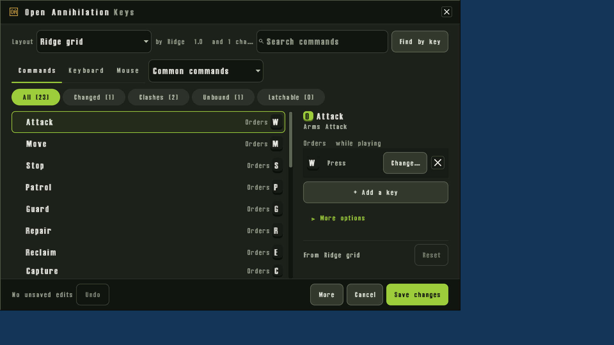
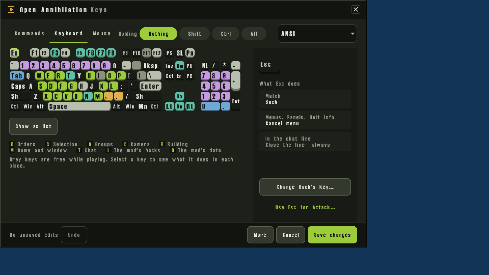
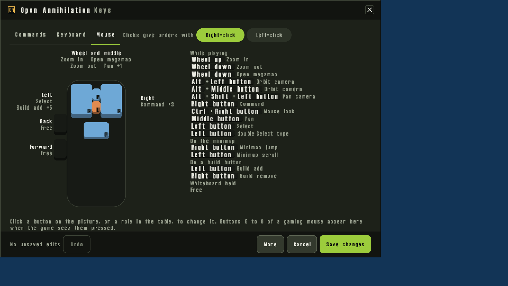
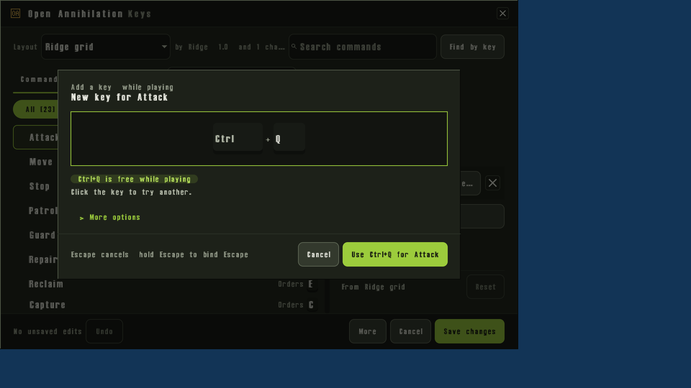
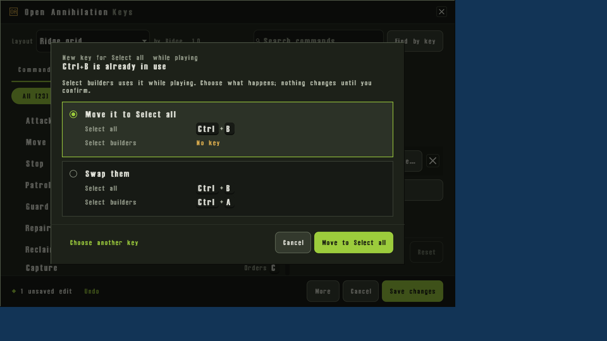
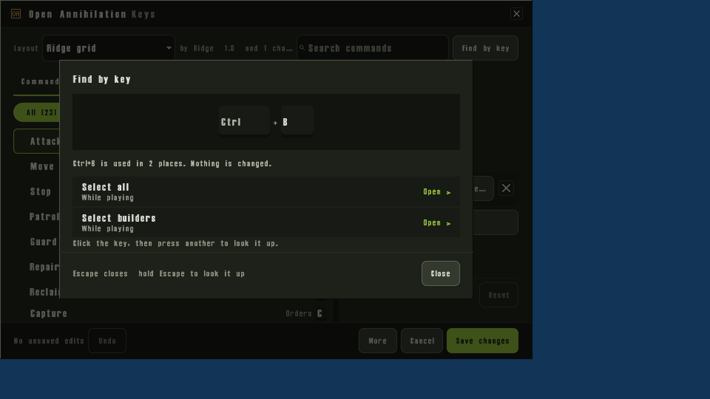
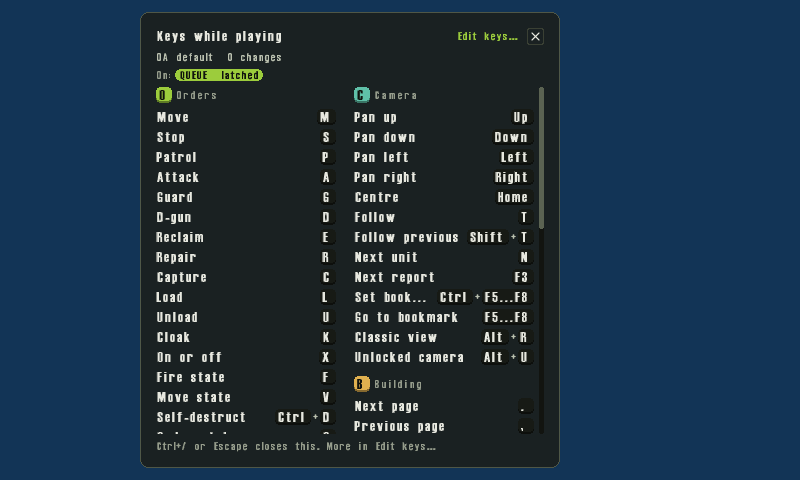

# Keys

Every command the game answers can be moved, including Settings, the
menus and the buttons on a unit's panel. This chapter is the map of those
commands: what a key is, how to change it, how a layout is kept and
shared, and the helpers for hands that need them.

The screens are [Settings › Controls](settings.md#controls) and
[Settings › Accessibility](settings.md#accessibility), the
[key editor](controls.md#the-key-editor), and the
[Library's Keys tab](library.md#the-keys-tab). A layout file follows the
[OAKeys standard](keys/oakeys-standard.md).

## Contents

- [Actions and chords](#actions-and-chords)
- [Letter or place](#letter-or-place)
- [Escape's one fixed job](#escapes-one-fixed-job)
- [The key editor](#the-key-editor)
- [Keys for a unit's tags](#keys-for-a-units-tags)
- [Layouts](#layouts)
- [Sharing a layout](#sharing-a-layout)
- [Older keys](#older-keys)
- [Accessibility](#accessibility)
- [Keys in a match](#keys-in-a-match)
- [Fairness](#fairness)
- [Files, preferences and the command line](#files-preferences-and-the-command-line)
- [The default keys](#the-default-keys)
- [A mod's own keys](#a-mods-own-keys)

## Actions and chords

A command is an action. Attack, Stop, Pause and the key that opens this
chapter's panel are actions. A chord is the key, the button or the wheel
turn that starts one, with the modifiers held while it is pressed.

One chord starts one action. The game does not run a chain of orders from
a single key. A command may have up to four chords. Two commands that can
both be reached at the same moment cannot share a chord: that is a clash,
and the editor asks what to do with it before it will save.

A command is a press, a key that repeats while it is held, a hold, a
modifier, a pointer button or a wheel turn. A hold and a modifier can
latch, one tap on and the next off, when the layout says so. The commands
that can latch are Queue, Add to selection, Queue five, Line build, Snap
override, Status strip and Draw. Line build, Snap override and Draw are
there while their hacks are on.

A held key repeats only for a command the game marks as a repeat: panning
the camera, the zoom keys, the build pages, and the game's speed, and,
while those hacks are on, a building line's spacing and the rotate key.

The [default keys](#the-default-keys) are what Open Annihilation ships,
with no mod hack changing them. A hack's own commands, and the chords a
hack puts on a shared command, are on that hack's page
([below](#a-mods-own-keys)).

## Letter or place

A chord is bound by the letter it types, or by the place the key sits.

A letter follows the character. Bind Attack to A and it stays on whichever
key types A, including on a keyboard where A is not where a US keyboard
puts it. A place stays on the same physical key on every keyboard. The
tables write a place as `@` and the key's name: `@Digit1` is the 1 above
the letters, `@KeyR` is where R sits on a US keyboard, and `Numpad1` is
the keypad. In the editor, **Same place on every keyboard** (under the
capture's More options) chooses a place; leaving it off chooses the
letter.

Modifiers are written in this order: Primary, Ctrl, Alt, Shift, then the
key. Primary is Command on a Mac and Ctrl on the other systems, so
Primary+5 and Ctrl+5 are the same keys on Windows, Linux and the Steam
Deck, and Primary+5 and Cmd+5 are on a Mac. The editor lists such a pair
as a clash on the system where it is one, and `oa-tool keys check` names
the systems where a layout's pair clashes. A double press is `:double`
(`MouseLeft:double` is the double click that selects the units of one
type). Letters in a stored chord are capitals.

The mouse is the same list. `MouseLeft`, `MouseRight` and `MouseMiddle`
are the buttons, and `WheelUp` and `WheelDown` the wheel. Which button
gives orders is the pointer scheme, Right-click or Left-click, on the
editor's Mouse tab. The tables give the right-click scheme, which is the
one the game starts with.

## Escape's one fixed job

Escape always closes the chat line, and it always closes Open
Annihilation's own screens. Those two chords are the only ones a layout
cannot take away:

| Command | Chord | Action |
| --- | --- | --- |
| Cancel chat | `Escape` | `chat.cancel` |
| Cancel screen | `Escape` | `ui.screen-cancel` |

A layout may add further chords to either command. It may not remove
Escape from them. The editor shows no Change… and no remove mark on that
chord.

**Back** (`game.back`) also starts on Escape, and on Ctrl+Escape, and that
one can be moved. Moving it does not take Escape off the chat line or off
Open Annihilation's screens. While a field is taking text, the field wins:
the key is typed, or it belongs to the input method, and it does not run
the command it is bound to. Escape still closes the field.
[Typing](typing.md#keys-while-a-field-is-open) says which chat keys move.

## The key editor

Edit keys… on the key layout card, Edit keys… on the keys panel and in
the Library, and Choose… beside Hold keys that latch open the editor. In
a game you play alone it pauses the game. It has three tabs:
**Commands**, **Keyboard** and **Mouse**.

**Commands** opens on Common commands, the commands players change first
(Attack, Move, Stop, Patrol and the rest), each with its area beside it.
Edit keys… and Edit keys… open there, on the All filter. A draft that
already has a clash, or a chord taken from another command, opens on
Clashes, across every area. Choose…, beside Hold keys that latch, opens
on Latchable. The other areas follow Common commands, and All actions
comes last. The filters are All, Changed, Clashes, Unbound and Latchable.
The search finds commands by name, description, area and a 3.1c order
word. In Common commands a search reaches every action, the common ones
first.

The chosen command's details sit beside the list, or on their own page at
Compact: what it does, where it works, each chord with **Change…** and a
mark that removes it, **+ Add a key**, and More options. More options
holds Latch and Hold to confirm where the command allows them, and Find
on keyboard. The foot of the details says where the keys come from, with
**Reset**.

Groups starts with **Number keys select groups**. That is 3.1c's
SwitchAlt. On, a digit alone selects its group, and Alt and the digit
picks a build button. It is saved with the layout. It is not one of the
changes the card counts as yours.

### The keyboard and the mouse

**Keyboard** draws the keyboard, ANSI, ISO or JIS, from the system or from
the choice beside it. Holding Shift, Ctrl, Alt or Cmd (where Primary is
Command) shows that layer. A click on a key only shows what it does. The
inspector offers **Change {command}'s key…** and **Use {key} for
{command}…**, and those open the capture. **Show as list** lists every
key that does something in the layer.

**Mouse** draws the buttons and the wheel, and the scheme, Right-click or
Left-click. A click on a button or a role opens the capture for it. The
scheme is saved with the layout, as Interface Type.

### Changing a key

Change… or + Add a key opens "New key for {command}" and listens. Press
the key, with its modifiers, or click or turn the wheel in the well.
Escape tapped cancels. Escape held for a second binds Escape. A line
under the well then says the chord is free, or names the commands that
already use it, or says why it is refused.

**Use {chord} for {command}** writes a free chord. A chord already in use
offers **Choose what happens…** instead. More options holds **Same place
on every keyboard**, and how the chord acts: a press, a double press or
a hold.

### Clashes

The clash question lists each way out and what it would leave on both
commands. **Move it to {command}** gives the chord to the command you are
editing. **Swap them** is there when you are changing a chord that
already exists. A press on a way out only marks it. The button named
after that way out writes it. **Choose another key** listens again, and
**Cancel** changes nothing.

A clash already in the edits, after a paste for example, shows on the
command as "{key} does two things", with **Settle…**. While a clash
stands, Save changes waits. A clash that lives only in a mod's own quick
keys stays listed and does not hold Save back; the layout's chord is the
one in use.

### Find by key

**Find by key**, beside the search, listens the same way and lists every
command on that chord, in every place it works. Open › shows that command
in the list. It changes nothing. Escape tapped closes it. Escape held for
a second looks Escape up.

### Reset

**Reset**, at the foot of the details, drops your edit of that one
command, so it goes back to the layout under it. **Undo** takes the last
edit back, and so does Ctrl+Z (Cmd+Z on a Mac) while the search is not
being typed in. **More** holds Import New Layout…, Clone as New
Layout…, Rename and Describe… and Restore Defaults under Layouts, and
Share My Custom Keys… and Paste Someone's Layout… under Sharing. Restore
Defaults clears your known edits and the helpers the
draft turned on, and puts Number keys select groups back. A command this
version of the game does not know is left as it was.

**Save changes** keeps the draft. **Cancel**, the close mark or Escape,
with edits not saved, asks whether to save them. Nothing you press on the
keyboard, in the inspector, in Find by key or on a way out of a clash
writes a chord until its own button does.

The editor's areas, in order, are Orders, Pointer, Selection, Groups,
Camera, Building, Game, Chat, Watching, Window, Menus, and then Developer
while Developer Mode is on. Megamap and Whiteboard are areas of their own
while those hacks are on. A hack's other commands stay in the area they
belong to, and the keys panel groups the ones that exist only because a
hack is on under **This mod**. Tags, for the units' category words, and
Menus, for a mod's own menu keys, follow the played mod.

## Keys for a unit's tags

Every word of the loaded units' Category lines can take a key. The editor
lists them under Tags, in the mod's name (or "Tags" when no mod is
named). The first press selects your units on screen that carry the word.
The second press selects them on the whole map. A Ctrl+letter selection
stays map-wide, as it is today. It does not use the two-press rule.

A word `CTRL_` and one letter uses a command that already exists, rather
than a new tag:

| Word | Action | Default |
| --- | --- | --- |
| `CTRL_B` | `select.builders` | `Ctrl+B` |
| `CTRL_C` | `select.commander` | `Ctrl+C` |
| `CTRL_F` | `select.factories` | `Ctrl+F` |
| `CTRL_V` | `select.aircraft` | `Ctrl+V` |

Any other `CTRL_` and a letter, when that Ctrl+letter chord is not
already a permanent command while playing, is
`select.category-<letter>`, and it starts on Ctrl and that letter. Every
other word is `select.tag-<word>`: the word in lower case, with spaces
and underscores turned to hyphens, when that piece is a run of letters,
digits and single hyphens at most 85 bytes. A word that does not fold to
such a piece has no key.

A `select.tag-` chord you have bound is kept when the units you loaded do
not carry the word. The editor shows it in Tags, greyed, with the aside
"not in the loaded units". The [standard](keys/oakeys-standard.md#51-action-ids)
names the family.

## Layouts

**OA default** is the layout the game ships. It is not a file, and it
cannot be renamed. The [default keys](#the-default-keys) are its chords.

A layout you install lives in the Library's
[Keys tab](library.md#the-keys-tab), and on disk under `Keys/<id>` in
your Open Annihilation folder
([where packages go](library.md#where-packages-go)). **Use** asks three
things before it switches:

1. **Where**, while a mod is played: every game, or only with that mod.
2. **Your changes** to the layout you are leaving: keep them on top of
   the new one, or start clean. Either way they stay saved with the
   layout you left.
3. **What moves**: each command whose key changes.

Under that, one switch for each helper the layout asks for, each on.
Leave a switch off and that setting stays as it is. Helpers act in every
game, including when the layout itself is only for one mod. **Undo** on
the notice afterwards puts the layout, the per-mod choice, the helpers
and this run's latches back. USE never deletes your own changes.

**Key layout with {mod}**, on Settings › Controls while a mod is played,
chooses the layout for that mod alone. Same as the game uses the layout
you chose for every game. The choice is
`open-annihilation.keys.layout.<mod id>`, and `same` means the shared
one. A layout made for that mod is marked made for it.

Your own changes are a layout of their own, `Keys/own-<id>/`, whose base
is the layout you changed. The card counts them ("4 changes of your
own"). They sit on top of the chosen layout: a command you have named
uses your chords, and one you have not named keeps the layout's.
`--keys` for one run does not lay them on top. See
[the command line](command-line.md#keys).

## Sharing a layout

**Share My Custom Keys…** in the editor's More menu shows the name and
the id that name folds to, one line with the layout the keys start from
and how many keys and helpers change, and two cards. With nothing
changed, the line says so and both cards' buttons are off.

- **As a file**: **Save File…** writes a `.oakeys` file anyone can open
  in Open Annihilation to install your layout, then says where, with
  **Open Folder**. The id is a lower-case name of 1 to 64 bytes. OA
  default, and an id that starts with `own-`, are refused.
- **As text**: **Copy as Text** copies the chords alone, for a forum or a
  chat, and says Copied. The card shows the text's first lines. The
  [text form](keys/oakeys-standard.md#9-the-text-form) is that copy.
- **Paste Someone's Layout…**, and Ctrl+V (Cmd+V on a Mac) while the
  search is not focused, reads the clipboard and lists each command it
  would change, with its key and, where needed, By place, Clash or Not in
  this version. **Apply** writes it into the draft. A chord that is
  already in use stays where it is and is listed as a clash, which holds
  Save changes until it is settled. A command this version does not know
  is kept for a version that has it. A clipboard that holds no key layout
  is refused, with what to do instead.

Nothing in Share, Paste or Import is in use until you save.

Opening a `.oakeys` file from the system asks to install it, and lists
any problem. The installer refuses a file that breaks the standard, and
still installs one that only warns.

## Older keys

tdraw, zdraw and cnc-ddraw each added keys of their own. Those
commands are in the game now. The chord a hack ships is on that hack's
page, and it applies while the hack is on. The base layout's chord, with
no hack, is in [the default keys](#the-default-keys).

**Import New Layout…** reads an older setup and lists the keys that differ.
IMPORT writes them into the draft, moving a chord off the command that
had it, and records where they came from. The three sources it offers
are:

- **A mod's Ctrl+F2 keys**, the three keys Open Annihilation kept for
  the mod: the click-snap hold, the line-build key and the rotate key.
- **tdraw's Settings.ini**, the named keys in that file's Settings.
- **cnc-ddraw's ddraw.ini**, its key lines.

The values in those files are Windows virtual-key numbers. The importer
turns them into places. A zero means the key was off. zdraw is not a
file the importer reads. Its megamap keys are the megamap commands,
changed in the editor.

The first time a mod with the build tools, click snap, the build preview
or the options dialog is played, those three stored keys are copied into
your own changes, once for that mod. A key is skipped when your changes
already name the command, when it is already the default, when it maps
to no chord, or when your changes cannot be read.
`open-annihilation.keys.imported` records the mods that have been done.
Number keys select groups is not part of that copy. It stays the switch
at the head of Groups.

| Tool | Key | Action | Where it is set now |
| --- | --- | --- | --- |
| tdraw, zdraw | Tab | `megamap.toggle` | The megamap hack's default. The editor lists it in Megamap. Import reads tdraw's MegaMapKey and MegamapKey |
| tdraw, zdraw | Wheel down, wheel up | `megamap.open-wheel`, `megamap.close-wheel` | The megamap hack's defaults |
| tdraw, zdraw | none | `megamap.jump` | Unbound. Set it in the editor |
| tdraw | hold `\` | `whiteboard.draw` | The whiteboard hack's default, `@Backslash`. Import reads WhiteboardKey |
| tdraw | Ctrl+`\` | `whiteboard.jump` | The whiteboard hack's default |
| tdraw | the mouse gestures | `whiteboard.line`, `.dot`, `.text`, `.move`, `.wipe`, `.erase` | The whiteboard hack's defaults, on the mouse |
| tdraw | hold X | `build.line` | The build-tools hack's default, `@KeyX`. Import reads BuildLinesRingsKey and KeyCode. The first start copies KeyCode |
| tdraw | Page Up, Page Down, the wheel | `build.spacing-up`, `build.spacing-down` | The build-tools hack's defaults |
| tdraw | hold Alt | `build.snap-override` | The click-snap and build-tools hacks. Import reads ClickSnapOverrideKey, and the first start copies it |
| tdraw, and the build-rotation hack | `/`, Shift+`/`, Alt+wheel | `build.rotate`, `build.rotate-wheel` | The build-preview and build-rotation hacks. Import reads RotateBuildKey, and the first start copies it |
| tdraw | Ctrl+S, Ctrl+B, Ctrl+F, and the box holds | `select.armed-on-screen`, `select.idle-builders`, `select.idle-factories`, `select.box-combat`, `select.box-builders`, `select.box-factories` | The selection-shortcuts hack. Idle builders replaces Select builders while it is on |
| tdraw | double-click on screen | `pointer.select-type-on-screen` | The selection-shortcuts hack. It stands in for Select type, and selects the selected types on screen while Double-click selects is On screen |
| tdraw | Ctrl+F2, F11 | `game.options-dialog`, `game.chat-macro` | The options-dialog hack |
| tdraw | F4, double-click a row | `game.resource-panel`, `watch.player-view`, `watch.lock-view` | The resource-panel hack. F4 is also the base **Kills board** while the hack is off |
| tdraw, cnc-ddraw | Ctrl+F9, and PrintScreen with the hack | `game.screenshot` | Ctrl+F9 is the base. The display-modes hack adds PrintScreen. Import reads cnc-ddraw's keyscreenshot |
| cnc-ddraw | the key in ddraw.ini, with Alt | `ui.full-screen` | Import reads keytogglefullscreen and adds Alt. The base chord is already `Alt+Enter` |
| cnc-ddraw | the key in ddraw.ini, with Alt | none | keytogglemaximize has no command |
| cnc-ddraw | the keys in ddraw.ini | `ui.release-pointer` | Unbound in the base. Import reads keyunlockcursor1 with Ctrl and keyunlockcursor2 with Alt, as its two chords |
| The old console remap | Insert, F10 | `game.repeat-command`, `debug.keys` | The base is `\` and F11. The key-remaps hack uses Insert, and F11 and F10 |
| The allies menu on every game | Tab, Shift+Tab | `game.team-menu` | The base is Tab. The alliance-menu hack adds Shift+Tab and widens where it works |
| 3.1c | the digit without Alt | Number keys select groups | The switch at the head of Groups. It is not imported |

## Accessibility

The helpers are Settings › Accessibility. Each takes effect at once. A
layout may ask for some of them; USE shows the ones it asks for and lets
you leave any of them off. The practice pad on that section tries a key
without it reaching the game.

| Helper | What it does | Default |
| --- | --- | --- |
| Hold keys that latch | How many latchable commands the layout has turned on. Choose… opens the editor on Latchable. A tap latches, a tap again lets go, and a chip shows each one that is on | None latched |
| Sticky modifiers | A tapped Shift, Ctrl or Alt holds for the next key or click. Tap twice to lock it. The system's own sticky keys still work | Off |
| Hold to confirm | Self-destruct, and Yes on the surrender question, wait until the long press finishes. A ring fills as you hold | Off |
| Long press | How long that hold is, and how long a chord bound as a hold must be held | 500 ms (200 to 1000, steps of 50) |
| Slow keys | A key counts only after it has been held this long | Off (then 50 to 1000 ms, steps of 50) |
| Bounce keys | A second press of the same key this soon is ignored | Off (then 50 to 1000 ms, steps of 50) |
| Order wheel | Holding the right button, or the middle, opens the order wheel at the pointer. A wedge gives that order, the same order the button would | Off |
| Pointer keys | The numpad moves the pointer. 5 clicks, 0 right-clicks, and the other pointer commands in the Pointer table do what they say | Off |
| Double press | How close two presses must be to count as a double press, and two clicks as a double click | System, the system's double-click time (or 200 to 1000 ms, steps of 50) |
| Key repeat delay | How soon a held repeat command starts repeating | System (or 150 to 1000 ms, steps of 50) |
| Key repeat rate | How fast it then repeats | System (or 2 to 30 a second) |
| Drag threshold | How far a press may move and still be a click | 32 px (32 to 96, steps of 8) |
| Edge scrolling | Off, the view does not scroll while the pointer rests at the window's edge. The arrow keys still move it | On |
| Move overlays | On, the keys panel, the chat line over the battlefield and the latch chips stand where you put them | Off |

**Arrange…** under Overlay places, while Move overlays is on, moves those
three. Each window size keeps its own places.
[Arrange overlays](controls.md#arrange-overlays) says how.

A layout made for a particular way of playing is an ordinary layout: it
turns on the helpers it needs, and USE asks before any of them change.
Nothing in Accessibility is reserved to one layout. The standard's tags
name those layouts, including `left-hand`, `one-hand`, `mouse-first` and
`accessibility`
([Tags](keys/oakeys-standard.md#31-tags)).

## Keys in a match

Ctrl+/ (Cmd+/ on a Mac) opens the keys panel: the commands that work
right now, grouped as the editor groups them, with a hack's own commands
under **This mod**. Its key is **Keys overlay** (`ui.keys-overlay`), and
it moves in the editor like any other. Edit keys… opens the editor.
Escape, or the same chord again, closes the panel. The match keeps
running, and a click or a key the panel does not use goes to the match.

With **Show keys on buttons** on, an order button wears its key in the
corner and a build cell wears its cell's key. The underlined letter on a
caption, where it has one, is the letter that presses it, so a key you
move leaves no line under the old letter. Resting on a button puts the
key at the end of the help line. While you place a building that can
turn, the hint is made from the rotate key and the wheel you have bound.

Latched holds, and a sticky modifier that is locked or held for the next
key, show as chips. With Move overlays off they stand at the top of the
battlefield. The panel's On line shows the same chips, and then the
battlefield does not. QUEUE reads QUEUE · latched until it is tapped
again.

Hold to confirm draws a ring that fills while the hold lasts, on the
button or at the pointer. Letting go early does not fire the command.

The order wheel, from the touch controls or from a held mouse button
when Order wheel says so, gives the order a wedge names. It does not
press the letter that order uses on the keyboard. Moving Stop off S
leaves the wheel's Stop where it is.
[The order wheel](touch-controls.md#the-order-wheel) and the
[pad](controllers.md#selecting-orders-and-building) say the same for a
finger and a gamepad.

[Keys in a match](controls.md#keys-in-a-match) is the longer account of
the panel, the badges and the help lines.

## Fairness

The layout and the helpers are yours alone. They are not part of the
match. Another player does not receive them, a saved game does not keep
them, and a recording does not keep them. Two players with different
keys play together as they always have.

One chord starts one action. There is no macro, and no chord that gives
several orders. A key repeats only for the camera, the zoom keys, the
build pages and the speed, and for a hack's spacing and rotate keys
while that hack is on. Pointer keys and the order wheel produce the same
orders a mouse and the order buttons would.

## Files, preferences and the command line

| What | Where |
| --- | --- |
| The layout in use | `open-annihilation.keys.layout`, an id, `oa-default` until you choose one |
| The layout for one mod | `open-annihilation.keys.layout.<mod id>`, `same` or a layout id |
| Show keys on buttons | `open-annihilation.keys.show-on-buttons` |
| The keyboard picture | `open-annihilation.keys.keyboard`, `system` or `ansi`, `iso` or `jis` |
| Mods whose stored keys were copied | `open-annihilation.keys.imported` |
| Installed layouts | `Keys/<id>` in your Open Annihilation folder |
| Your own changes | `Keys/own-<id>/oakeys.yaml` |
| Overlay places | `open-annihilation.overlay.<overlay>.<layout>`, the overlay `keys-overlay`, `chat-line` or `latch-chips`, the layout `compact`, `regular` or `large` |
| The helpers | `open-annihilation.access.sticky-modifiers`, `.pointer-keys`, `.hold-to-confirm`, `.edge-scroll`, `.move-overlays`, `.order-wheel`, `.slow-keys-ms`, `.bounce-keys-ms`, `.double-press-ms`, `.long-press-ms`, `.repeat-delay-ms`, `.repeat-rate`, `.drag-threshold` |

A helper you have never changed is not written, and follows the default
in the table above. Latches are not a preference of their own: they are
the layout's list of commands that latch. The installation guides say
where the preferences file and the Open Annihilation folder are.
[Settings](settings.md#where-the-settings-are-kept) says the same for
every other setting.

For one run, [`--keys`](command-line.md#keys) plays a layout and does not
save it and does not lay your own changes on top. `--keys-reset` plays
OA default with no own changes, and does not save that either.
[`--trace-input`](command-line.md#--trace-input) prints each action a
press became, with the chord that matched.

## The default keys

These are `oa-default`, with no hack on. A dash means the command has no
default chord. The chords are the text the game stores: a place is `@`
and the key's name, Primary is Command on a Mac and Ctrl elsewhere, and
`:double` is a double press. Developer is listed while Developer Mode is
on.

### Orders

| Command | Default keys | Action |
| --- | --- | --- |
| Move | `M` | `order.move` |
| Stop | `S` | `order.stop` |
| Patrol | `P` | `order.patrol` |
| Attack | `A` | `order.attack` |
| Guard | `G` | `order.guard` |
| D-gun | `D` | `order.dgun` |
| Reclaim | `E` | `order.reclaim` |
| Repair | `R` | `order.repair` |
| Capture | `C` | `order.capture` |
| Load | `L` | `order.load` |
| Unload | `U` | `order.unload` |
| Cloak | `K` | `order.cloak` |
| On or off | `X` | `order.on-off` |
| Fire state | `F` | `order.fire-state` |
| Move state | `V` | `order.move-state` |
| Self-destruct | `Ctrl+D` | `order.self-destruct` |
| Orders tab | `O` | `panel.orders-tab` |
| Build tab | `B` | `panel.build-tab` |
| Queue | `Shift` | `order.queue-modifier` |
| Force attack | `Ctrl` | `order.force-modifier` |
| Cancel order | — | `order.cancel` |

### Pointer

| Command | Default keys | Action |
| --- | --- | --- |
| Select | `MouseLeft` | `pointer.select` |
| Command | `MouseRight` | `pointer.command` |
| Select type | `MouseLeft:double` | `pointer.select-type` |
| Add to selection | `Shift` | `select.add-modifier` |
| Pan | `MouseMiddle` | `pointer.pan` |
| Orbit camera | `Alt+MouseLeft, Alt+MouseMiddle` | `pointer.camera-orbit` |
| Pan camera | `Alt+Shift+MouseLeft` | `pointer.camera-pan` |
| Mouse look | `Ctrl+MouseRight` | `pointer.mouse-look` |
| Minimap jump | `MouseRight` | `pointer.minimap-jump` |
| Minimap scroll | `MouseLeft` | `pointer.minimap-scroll` |
| Zoom in | `WheelUp` | `camera.zoom-in` |
| Zoom out | `WheelDown` | `camera.zoom-out` |
| Queue five | `Shift` | `build.queue-modifier` |
| Build add | `MouseLeft` | `build.add` |
| Build remove | `MouseRight` | `build.remove` |
| Pointer up | `Numpad8` | `pointer.move-up` |
| Pointer down | `Numpad2` | `pointer.move-down` |
| Pointer left | `Numpad4` | `pointer.move-left` |
| Pointer right | `Numpad6` | `pointer.move-right` |
| Pointer up left | `Numpad7` | `pointer.move-up-left` |
| Pointer up right | `Numpad9` | `pointer.move-up-right` |
| Pointer down left | `Numpad1` | `pointer.move-down-left` |
| Pointer down right | `Numpad3` | `pointer.move-down-right` |
| Pointer click left | `Numpad5` | `pointer.click-left` |
| Pointer click right | `Numpad0` | `pointer.click-right` |
| Pointer hold left | `NumpadAdd` | `pointer.hold-left` |
| Pointer let go | `NumpadDecimal` | `pointer.let-go` |

**Select type** selects your units of the clicked unit's type: those the
battlefield shows, or every one on the map, as **Double-click selects**
in [Settings › Controls](settings.md#controls) says. On screen is the
default; On the map is 3.1c's double click. **Select same type**
(Ctrl+Z) selects the selected types on the whole map either way.

### Selection

| Command | Default keys | Action |
| --- | --- | --- |
| Select all | `Ctrl+A` | `select.all` |
| Select builders | `Ctrl+B` | `select.builders` |
| Select factories | `Ctrl+F` | `select.factories` |
| Select aircraft | `Ctrl+V` | `select.aircraft` |
| Select on screen | `Ctrl+S` | `select.on-screen` |
| Select commander | `Ctrl+C` | `select.commander` |
| Add commander | `Ctrl+Shift+C` | `select.commander-add` |
| Select same type | `Ctrl+Z` | `select.same-type` |
| Next primary | `Tab` | `select.next-primary` |
| Previous primary | `Shift+Tab` | `select.previous-primary` |
| Clear selection | — | `select.clear` |

### Groups

| Command | Default keys | Action |
| --- | --- | --- |
| Assign group 1 | `Ctrl+@Digit1, Ctrl+Numpad1` | `group.assign-1` |
| Assign group 2 | `Ctrl+@Digit2, Ctrl+Numpad2` | `group.assign-2` |
| Assign group 3 | `Ctrl+@Digit3, Ctrl+Numpad3` | `group.assign-3` |
| Assign group 4 | `Ctrl+@Digit4, Ctrl+Numpad4` | `group.assign-4` |
| Assign group 5 | `Ctrl+@Digit5, Ctrl+Numpad5` | `group.assign-5` |
| Assign group 6 | `Ctrl+@Digit6, Ctrl+Numpad6` | `group.assign-6` |
| Assign group 7 | `Ctrl+@Digit7, Ctrl+Numpad7` | `group.assign-7` |
| Assign group 8 | `Ctrl+@Digit8, Ctrl+Numpad8` | `group.assign-8` |
| Assign group 9 | `Ctrl+@Digit9, Ctrl+Numpad9` | `group.assign-9` |
| Select group 1 | `Alt+@Digit1, Alt+Numpad1` | `group.select-1` |
| Select group 2 | `Alt+@Digit2, Alt+Numpad2` | `group.select-2` |
| Select group 3 | `Alt+@Digit3, Alt+Numpad3` | `group.select-3` |
| Select group 4 | `Alt+@Digit4, Alt+Numpad4` | `group.select-4` |
| Select group 5 | `Alt+@Digit5, Alt+Numpad5` | `group.select-5` |
| Select group 6 | `Alt+@Digit6, Alt+Numpad6` | `group.select-6` |
| Select group 7 | `Alt+@Digit7, Alt+Numpad7` | `group.select-7` |
| Select group 8 | `Alt+@Digit8, Alt+Numpad8` | `group.select-8` |
| Select group 9 | `Alt+@Digit9, Alt+Numpad9` | `group.select-9` |
| Add group 1 | `Alt+Shift+@Digit1, Alt+Shift+Numpad1` | `group.add-1` |
| Add group 2 | `Alt+Shift+@Digit2, Alt+Shift+Numpad2` | `group.add-2` |
| Add group 3 | `Alt+Shift+@Digit3, Alt+Shift+Numpad3` | `group.add-3` |
| Add group 4 | `Alt+Shift+@Digit4, Alt+Shift+Numpad4` | `group.add-4` |
| Add group 5 | `Alt+Shift+@Digit5, Alt+Shift+Numpad5` | `group.add-5` |
| Add group 6 | `Alt+Shift+@Digit6, Alt+Shift+Numpad6` | `group.add-6` |
| Add group 7 | `Alt+Shift+@Digit7, Alt+Shift+Numpad7` | `group.add-7` |
| Add group 8 | `Alt+Shift+@Digit8, Alt+Shift+Numpad8` | `group.add-8` |
| Add group 9 | `Alt+Shift+@Digit9, Alt+Shift+Numpad9` | `group.add-9` |
| Menu page 1 | `@Digit1, Numpad1` | `build.page-1` |
| Menu page 2 | `@Digit2, Numpad2` | `build.page-2` |
| Menu page 3 | `@Digit3, Numpad3` | `build.page-3` |
| Menu page 4 | `@Digit4, Numpad4` | `build.page-4` |
| Menu page 5 | `@Digit5, Numpad5` | `build.page-5` |
| Menu page 6 | `@Digit6, Numpad6` | `build.page-6` |
| Menu page 7 | `@Digit7, Numpad7` | `build.page-7` |
| Menu page 8 | `@Digit8, Numpad8` | `build.page-8` |
| Menu page 9 | `@Digit9, Numpad9` | `build.page-9` |

### Camera

| Command | Default keys | Action |
| --- | --- | --- |
| Pan up | `Up` | `camera.pan-up` |
| Pan down | `Down` | `camera.pan-down` |
| Pan left | `Left` | `camera.pan-left` |
| Pan right | `Right` | `camera.pan-right` |
| Centre | `Home` | `camera.centre` |
| Follow | `T` | `camera.follow` |
| Follow previous | `Shift+T` | `camera.follow-previous` |
| Next unit | `N` | `camera.next-unit` |
| Next report | `F3, Ctrl+F3` | `camera.next-report` |
| Set bookmark 1 | `Ctrl+F5` | `camera.bookmark-set-1` |
| Set bookmark 2 | `Ctrl+F6` | `camera.bookmark-set-2` |
| Set bookmark 3 | `Ctrl+F7` | `camera.bookmark-set-3` |
| Set bookmark 4 | `Ctrl+F8` | `camera.bookmark-set-4` |
| Go to bookmark 1 | `F5` | `camera.bookmark-go-1` |
| Go to bookmark 2 | `F6` | `camera.bookmark-go-2` |
| Go to bookmark 3 | `F7` | `camera.bookmark-go-3` |
| Go to bookmark 4 | `F8` | `camera.bookmark-go-4` |
| Zoom in key | — | `camera.zoom-in-key` |
| Zoom out key | — | `camera.zoom-out-key` |
| Reset zoom | — | `camera.zoom-reset` |
| Classic view | `Alt+@KeyR` | `camera.classic-view` |
| Unlocked camera | `Alt+@KeyU` | `camera.unlocked` |
| Edge scroll | — | `camera.edge-scroll` |

### Building

| Command | Default keys | Action |
| --- | --- | --- |
| Next page | `.` | `build.page-next` |
| Previous page | `,` | `build.page-previous` |
| Build cell 1 | — | `build.cell-1` |
| Build cell 2 | — | `build.cell-2` |
| Build cell 3 | — | `build.cell-3` |
| Build cell 4 | — | `build.cell-4` |
| Build cell 5 | — | `build.cell-5` |
| Build cell 6 | — | `build.cell-6` |
| Build cell 7 | — | `build.cell-7` |
| Build cell 8 | — | `build.cell-8` |
| Build cell 9 | — | `build.cell-9` |
| Build cell 10 | — | `build.cell-10` |
| Build cell 11 | — | `build.cell-11` |
| Build cell 12 | — | `build.cell-12` |
| Move queued site | `Shift+MouseLeft` | `build.move-queued-site` |

### Game

| Command | Default keys | Action |
| --- | --- | --- |
| Back | `Escape, Ctrl+Escape` | `game.back` |
| Game menu | `F2, Ctrl+F2` | `game.menu` |
| Pause | `Pause, Ctrl+Pause` | `game.pause` |
| Speed up | `@Equal, NumpadAdd` | `game.speed-up` |
| Speed down | `@Minus, NumpadSubtract` | `game.speed-down` |
| Unit info | `F1, Ctrl+F1` | `game.unit-info` |
| Pin unit | `Shift+F1, Ctrl+Shift+F1` | `game.pin-unit` |
| Kills board | `F4, Ctrl+F4` | `game.kill-board` |
| Status strip | `Space` | `game.status-strip` |
| Damage bars | `@Backquote` | `game.health-bars` |
| Damage bar mode 1 | `Shift+@Digit1` | `game.health-bars-mode-1` |
| Damage bar mode 2 | `Shift+@Digit3` | `game.health-bars-mode-2` |
| Damage bar mode 3 | `Shift+@Digit8` | `game.health-bars-mode-3` |
| Damage bar mode 4 | `Shift+@Backquote` | `game.health-bars-mode-4` |
| Clear messages | `F12, Ctrl+F12` | `game.clear-messages` |
| Screenshot | `Ctrl+F9` | `game.screenshot` |
| Allies menu | `Tab` | `game.team-menu` |
| Share panel | `H` | `game.share-panel` |
| Repeat command | `\` | `game.repeat-command` |
| Open chat | `Enter` | `chat.open` |
| Open allies chat | — | `chat.open-allies` |

### Chat

| Command | Default keys | Action |
| --- | --- | --- |
| Send chat | `Enter, Ctrl+Enter` | `chat.send` |
| Cancel chat | `Escape` | `chat.cancel` |

### Window

| Command | Default keys | Action |
| --- | --- | --- |
| Settings | `Primary+,` | `ui.settings` |
| Full screen | `Alt+Enter` | `ui.full-screen` |
| Keys overlay | `Primary+/` | `ui.keys-overlay` |
| Release pointer | — | `ui.release-pointer` |
| Quit | — | `ui.quit` |
| Accept | `Enter` | `ui.screen-accept` |
| Cancel screen | `Escape` | `ui.screen-cancel` |
| Up | `Up` | `ui.screen-up` |
| Down | `Down` | `ui.screen-down` |
| Left | `Left` | `ui.screen-left` |
| Right | `Right` | `ui.screen-right` |
| Press | `Space` | `ui.screen-press` |
| Next control | `Tab` | `ui.screen-focus-next` |
| Previous control | `Shift+Tab` | `ui.screen-focus-previous` |
| Page up | `PageUp` | `ui.screen-page-up` |
| Page down | `PageDown` | `ui.screen-page-down` |
| Go to start | `Home` | `ui.screen-home` |
| Go to end | `End` | `ui.screen-end` |
| Yes | `Y` | `ui.screen-yes` |
| No | `N` | `ui.screen-no` |
| Information | `F1` | `ui.screen-info` |
| Paste | `Primary+V, Ctrl+V` | `ui.screen-paste` |
| Find | `Primary+F, /` | `ui.screen-find` |
| Refresh | `F5` | `ui.screen-refresh` |
| Next tab | `Ctrl+Tab` | `ui.screen-next-tab` |
| Previous tab | `Ctrl+Shift+Tab` | `ui.screen-previous-tab` |

### Menus

| Command | Default keys | Action |
| --- | --- | --- |
| Accept | `Enter` | `ui.menu-accept` |
| Cancel menu | `Escape` | `ui.menu-cancel` |
| Press button | `Space` | `ui.menu-press` |
| Next button | `Tab` | `ui.menu-focus-next` |
| Previous button | `Shift+Tab` | `ui.menu-focus-previous` |
| Focus up | — | `ui.menu-focus-up` |
| Focus down | — | `ui.menu-focus-down` |
| Focus left | `Left` | `ui.menu-focus-left` |
| Focus right | `Right` | `ui.menu-focus-right` |
| List up | `Up, WheelUp` | `ui.menu-list-up` |
| List down | `Down, WheelDown` | `ui.menu-list-down` |

### Developer

These show in the editor while Developer Mode is on.

| Command | Default keys | Action |
| --- | --- | --- |
| Debug keys | `F11` | `debug.keys` |
| Movie capture | `Ctrl+F10` | `debug.movie-capture` |
| Refill | `=` | `debug.refill` |
| Kill under pointer | `]` | `debug.kill-under-pointer` |
| Developer info | `I` | `debug.i` |
| Overlay | `M` | `debug.overlay` |

## A mod's own keys

Each standard hack that adds or moves keys lists them on its own page.
The table there is the chords while the hack is on. They move in the
[key editor](#the-key-editor). Megamap and Whiteboard are groups of their
own. The others stay in the area the command belongs to: Pointer,
Selection, Building, Game, Watching or Developer. The keys panel puts a
hack's own commands under **This mod**.

- [Megamap](mods/standard-hacks/ui.megamap.md#keys), in Megamap
- [Whiteboard](mods/standard-hacks/ui.whiteboard.md#keys), in Whiteboard
- [Resource panel](mods/standard-hacks/ui.resource-panel.md#keys), in
  Game and Watching
- [Selection shortcuts](mods/standard-hacks/ui.selection-shortcuts.md#keys),
  in Pointer and Selection
- [Build tools](mods/standard-hacks/ui.build-tools.md#keys), in Building
- [Click snap](mods/standard-hacks/ui.click-snap.md#keys), in Building
- [Build preview](mods/standard-hacks/ui.build-preview.md#keys), in
  Building
- [Options dialog](mods/standard-hacks/ui.options-dialog.md#keys), in Game
- [Display modes](mods/standard-hacks/ui.display-modes.md#keys), in Game
- [Key remaps](mods/standard-hacks/console.key-remaps.md#keys), in Game
  and Developer
- [Alliance menu everywhere](mods/standard-hacks/teams.alliance-menu-all-game-types.md#keys),
  in Game
- [Build rotation](mods/standard-hacks/units.build-rotation.md#keys), in
  Building
