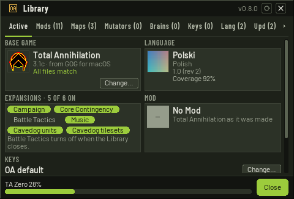
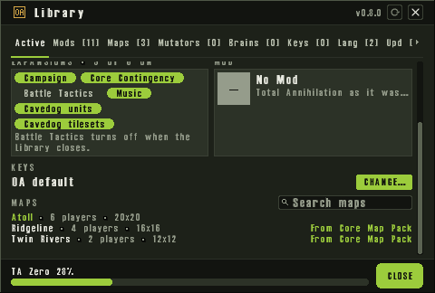
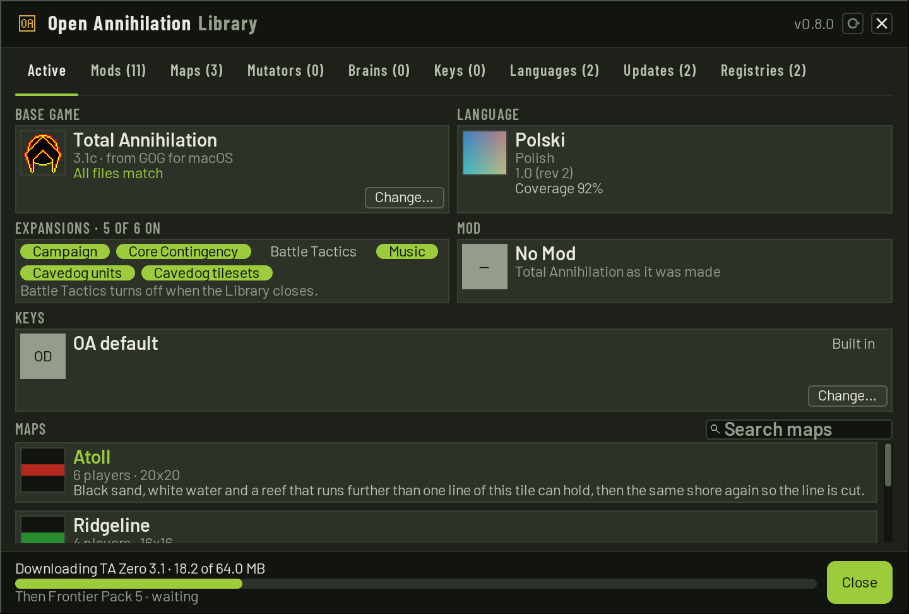
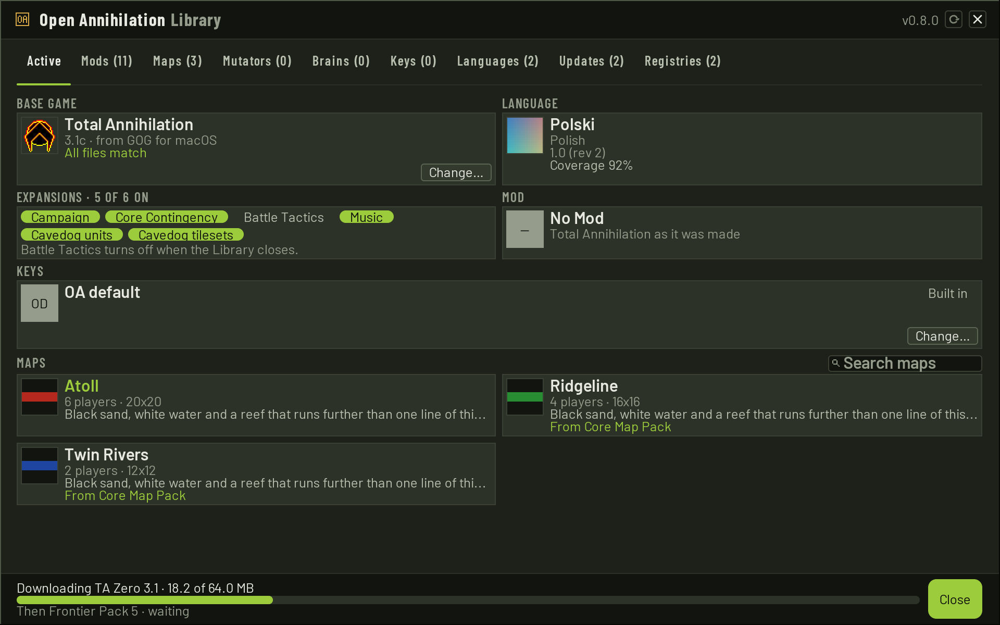
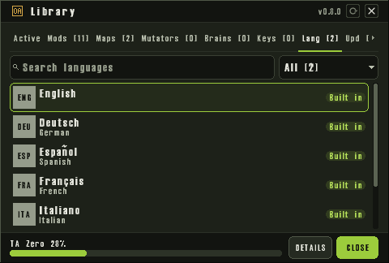
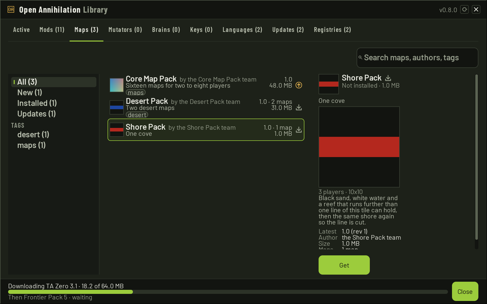
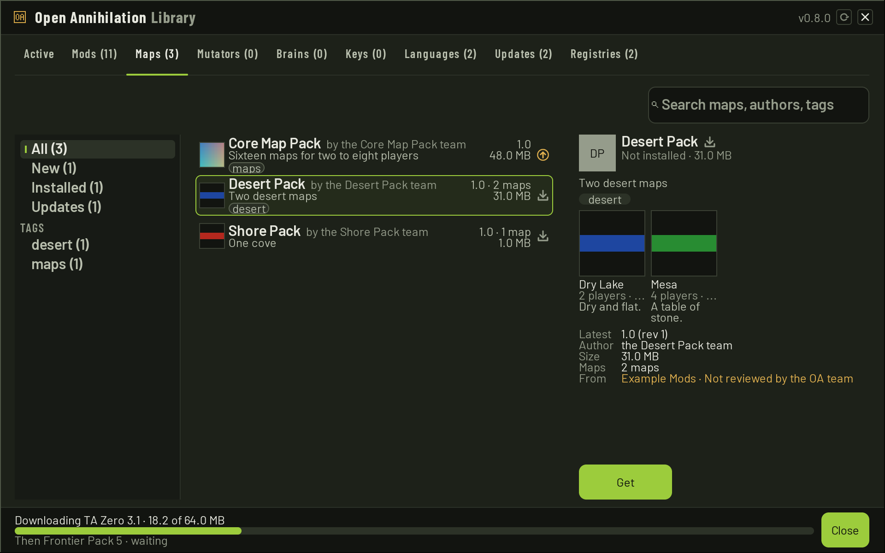
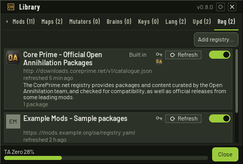
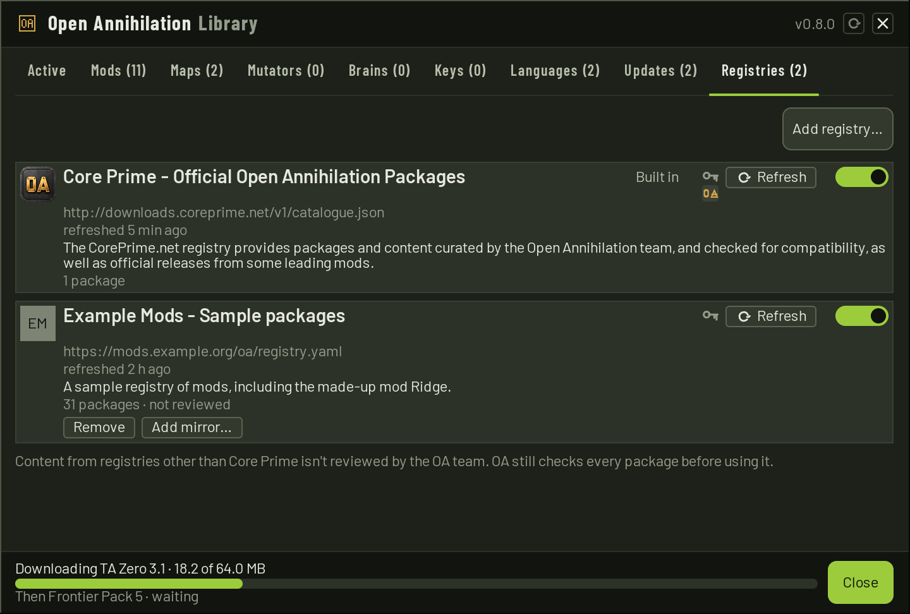
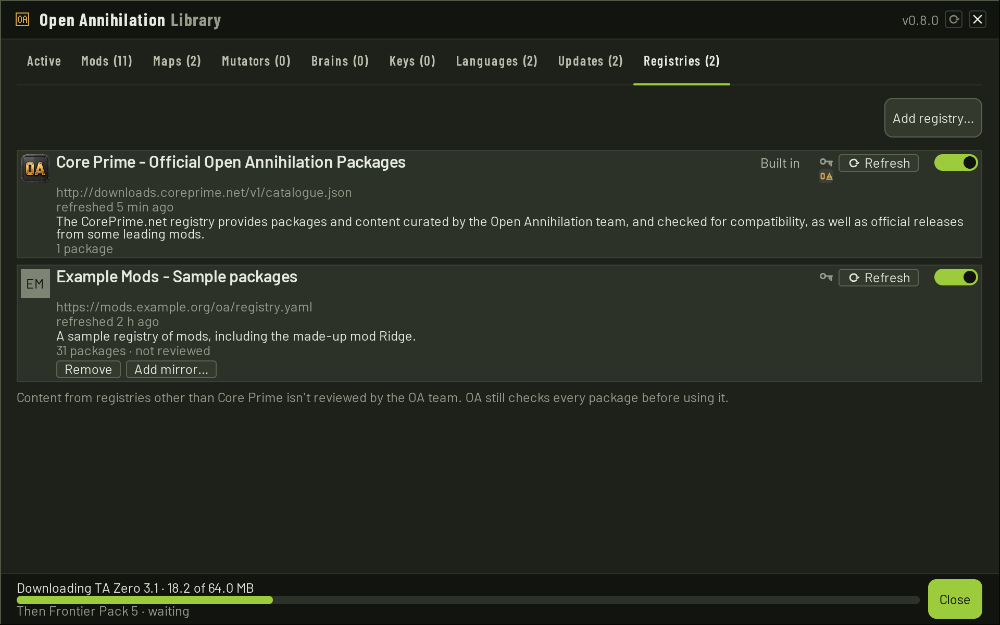

# The Library

The Library is where Open Annihilation finds, installs, updates, rolls
back and uninstalls mods, map packs, mutators and language packs without
leaving the game, and where you choose the mod you play. It also lists
brains: you get one here, update it and uninstall it, and you choose
which computer player new seats start with. A brain has no roll back.
It lists
every package that Core Prime's registry, built into the game, and any
registry you added offer, together with what you have installed, and it
says for each whether you have it, whether an update waits, and what it
would change.

[Downloads and privacy](downloads.md) explains registries, the Downloads
settings and exactly what a download sends and records.
[Mod support](mods/README.md) covers mods themselves, and
[map packs](maps/README.md) and [languages](languages.md) theirs.
Switching a mutator on is
[Playing with mutators](playing-with-mutators.md).
Choosing a brain is [Playing with brains](playing-with-brains.md).

## Contents

- [Opening the Library](#opening-the-library)
- [The Active tab](#the-active-tab)
- [Tabs and states](#tabs-and-states)
- [The Mutators tab](#the-mutators-tab)
- [The Brains tab](#the-brains-tab)
- [Search and filters](#search-and-filters)
- [The details](#the-details)
- [Choosing a mod](#choosing-a-mod)
- [Keys and controllers](#keys-and-controllers)
- [Installing](#installing)
- [The download queue](#the-download-queue)
- [Updates](#updates)
- [The Registries tab](#the-registries-tab)
- [Which downloads ask first](#which-downloads-ask-first)
- [The update question](#the-update-question)
- [Rolling back](#rolling-back)
- [Uninstalling](#uninstalling)
- [Finishes when you leave …](#finishes-when-you-leave-)
- [Offline](#offline)
- [Check that you're a person](#check-that-youre-a-person)
- [Where packages go](#where-packages-go)

## Opening the Library

The Library opens on the main menu, from:

- **the OA button**, the plates over drive bays at the bottom right of
  the main menu, a 48-pixel square left of the **Settings** button and its
  gears (the same size, a quarter of a side apart, 12 pixels in from the
  frame). It opens on the [Active](#the-active-tab) tab. Its bottom-right
  corner shows how many packages you have added: mods, map packs, mutators,
  language packs and downloaded expansions. An installed brain is left out
  of that count. The base game and a language the game
  holds itself are left out, and a map pack counts once: `7`, `123`, or
  `999+` above 999. While the catalogues are still being read and that
  number is not final, a small spinner turns there instead, and stops once
  the list is in. The button's text says the same count, "Library · 1
  package" or "Library · N packages", and "Library · N packages · M updates"
  while updates wait. While the count is not final the package count is
  left out. The welcome's Library mark says what the number counts. While
  updates you can install wait, the button also wears an amber dot in its
  top right corner, from the moment OA finds them: you
  need not open the Library to learn of them, and its **Updates** tab lists
  them;
- **MORE IN THE LIBRARY…** in Settings › Language, which opens it on
  Languages, over the settings, which stay open under it.

The
skirmish and battle room map lists have **MORE MAPS…** instead, which opens
the map browser, and the battle room has **GET MAP**, which downloads the
host's map without a detour ([map packs](maps/README.md)).

The first time the main menu is reached, a welcome points out these two
buttons, after a language and a choice about online features
([the welcome setup](first-run.md)). Settings › System can show that
welcome again.

The settings have a button of their own on the main menu, the gears beside
the OA button, which opens them with no Library under them
([settings](settings.md#opening-the-settings)). From the Library, **Cmd+,**
on macOS and **Ctrl+,** elsewhere opens them over the Library. The header's
top right holds a refresh icon, and a close mark to its right. Pressing
the refresh icon, or F5, asks the registries
for their lists at once ([updates](#updates)). While they are being asked
the icon turns, one full turn every 1.6 seconds, and it cannot be pressed
again until they answer. When the refresh has read a list, the icon shows
a check for 0.8 seconds and then the arrow again. A refresh that fails goes
straight back to the arrow; the offline line says why. Pressing it during
the check asks again at once. The close mark does what **CLOSE** does.
**CLOSE**, or Escape, goes back to the main menu.
The Library shows only on the main menu: it closes when the menu gives way
to another screen, and in a game the in-game menu's button, which shows the
gears too, opens the settings, not the Library.

The Library lays itself out for the room the window gives it, at the
Interface size in Settings › Graphics ([settings](settings.md#graphics)):
in the Compact layout, as on a 640x480 window, the list fills the window
and an entry's details are a page of their own; in the Regular and Large
layouts the details sit beside the list, and Large adds a column of
filters.

## The Active tab

**Active**, the first tab, shows what you are using now, as tiles. At
every size, including a small window, the first row is **BASE GAME** and
**LANGUAGE**, and the second is **EXPANSIONS** and **MOD**. **MAPS** stays
under them, so the maps pane keeps a row.

- **BASE GAME**: the game you play, and its version ("Total Annihilation",
  "3.1c", or "Demo"). Its badge is Total Annihilation's own icon, taken
  from the program in the game folder that describes itself as Total
  Annihilation, and drawn centred in the square. When that program cannot
  be read, the Library draws the icon it ships, the same one for Total
  Annihilation and the demo, including on the chooser. The letters "TA"
  stay only when that picture cannot be drawn. A source the
  host knows is named on the version line ("3.1c · from GOG for macOS").
  A file check the host knows is the next line: "All files match", or
  "1 file differs", or "2 files differ". **CHANGE…** sits at the bottom
  right. It opens the base game chooser over the Library. **CHANGE…** is
  greyed during a game, while the command line named the choice for this
  run, and while the command line chose the run's mod.
- **EXPANSIONS**: one pill for each expansion of that base game. A pill
  that is on is filled. One that is copied and off is plain, in the
  expansion's name. One that is not copied, and that a registry offers,
  keeps the expansion's name and carries the download arrow at the right,
  inside the chip. The whole chip is the press. It downloads and installs
  the expansion, with the same progress and errors as any other package,
  and pressing it again cancels a download that is in the queue or tries
  again after a failure. When the copy is
  in the game's folder the pill turns on. The choice applies when the
  Library closes, as any other expansion change does, and the expansion
  is not mounted while the Library stays open. One that no registry
  offers reads "Campaign · ADD FROM…", and that press is the control that
  will open the locator; this tab does not open it. The heading counts
  them, "EXPANSIONS · 5 OF 6 ON". A game
  with none says "EXPANSIONS" and "This game has no expansions." A hint
  under the pills names what the first expansion that is off still needs
  ("Core Contingency needs Campaign."). Pressing a pill follows the
  rules for turning an expansion on or off, and the choice waits on this
  tab until the Library closes. The hint then names that wait ("Battle
  Tactics turns off when the Library closes."). Turning one off that the
  mod you are playing needs asks first. **CANCEL** leaves the choice as
  it was. **TURN OFF** keeps the change on this tab, still until the
  Library closes, and says that the mod is unloaded and the game plays
  with **No Mod**. The hint then names the mod and the expansion: "Ridge
  was unloaded because Campaign is off. The game plays with No Mod."
  Turning that expansion back on clears the sentence. While the command
  line chose the mod, the Library cannot unload it, so the pill of an
  expansion it needs is locked while it is on: it stays filled but faded,
  pressing it does nothing, and Tab passes over it. The same goes for an
  expansion that would take a needed one off with it, as Campaign takes
  Core Contingency. Under the pills, beside a padlock in amber, the
  Library says why: "The command line chose this run's mod, which needs
  Campaign." A pill that is off still turns on. When a stored note
  says a mod was cleared for the same reason, and this tab has not edited
  the choice, the hint is "The mod was unloaded because an expansion it
  needs is off. The game plays with No Mod." The pills are greyed during
  a game and while the command line named the choice for this run. When
  the Library closes, a change of base game or of the expansions that are
  on is mounted the way a mod switch is: the window stays and the intro
  is skipped. The files are not mounted again while the Library stays
  open, nor during a game. Choosing another base game turns on every
  expansion of it that is copied and unloads the mod you are playing.
  The chooser says so, and the change applies when the Library closes.
  Choosing the base game you started with again, before the Library
  closes, plays that mod again. A base game that is not copied asks for
  its source and copies it before that choice is kept. The demo asks for
  its installer. **USE THIS GAME** keeps the marked game. **CANCEL**
  leaves the choice as it was.
- **MOD**: a tile for the mod you are playing. Its badge is large, and the
  tile names the mod, its version and revision ("4.8 (rev 3)") and who made
  it ("by the Ridge team"). **Playing** is a rounded pill at the top right,
  on the title's line. **UNLOAD MOD** sits at the bottom right. It asks the
  same **SWITCH MOD** question as **SWITCH OFF** and, on **SWITCH**, goes
  back to the game as it was made
  ([choosing a mod](#choosing-a-mod)). It is greyed during a game and while
  the command line chose the run's mod; resting on it then shows "The
  command line chose this run's mod." When you are playing no mod, the
  tile is **No Mod**. Its badge is an em dash. The tile reads "No Mod"
  and "Total Annihilation as it was made", and it has no pill and no button.
- **LANGUAGE**: a tile for the language the game is showing. It carries the
  pack's badge, or a language mark, the language's name in itself and in
  English, the pack's version and revision, and how much of the game the
  pack covers ("Coverage 92%"). When the game is showing a language it
  holds itself, **Built in** is a rounded pill at the top right, on the
  title's line, in a muted ground so it does not look like an installed
  chip.
- **MAPS**: each map you have installed. On a small window a map is one
  line: its name, how many players it is for and its size ("Twin Rivers ·
  2 players · 12x12"). On a larger window it is a tile with that map's
  minimap, its title, its players and size ("4 players · 16x16"), and its
  description cut to one line. When the pack holds several maps, **From**
  and the pack's name is a link: at the right of the line on a small
  window, and under the lines on a tile. When the pack holds just that
  map, there is no **From** line: the title is the link, in the same accent,
  lighter while the pointer rests on it. Choosing the link, with the
  pointer, Enter or a controller's A, opens the Maps tab with that pack
  selected and its row in view. When you have no map pack, the pane says
  "No map packs are installed."

  The **MAPS** heading stays put, with a search field at its right,
  **Search maps**. Typing there leaves the maps whose name or pack name
  contains what you typed, ignoring capitals. While the field holds text
  the heading counts them, "2 of 5". When none match, the pane says "No
  installed map matches." Clearing the field shows every map again. The
  words stay while the Library is open, including on the other tabs. The
  search does not hide the four tiles above it.

The badge, the title and the lines start at the top of each tile, with the
same small padding above them and below the last line or, on a tile with a
button, below **CHANGE…** or **UNLOAD MOD**. In a row, the two tiles share
a title line and the same height, and so do maps in one row. Extra room
stays under the shorter tile's lines. A minimap keeps its shape: it is
centred in its square, and the rest of the square is the list's well colour.

The four tiles stand two by two at every size. On a small window each map
is one line. On the largest the maps stand in two columns when you have
more than one. The tab has no catalogue search and no filters. The base,
expansions, mod and language labels and each map's title line take no
press, except the title of a map whose pack holds only that map: that
title is the link to the pack. **CHANGE…**, each expansion pill but a
locked one (the
download arrow sits inside a pill a registry offers, and that pill is
the press), **UNLOAD MOD**, each map's link to its pack while that link
shows, and the maps search do take a press. Tab and the arrows reach
them. The expansions hint wraps onto as many lines as it needs.

On a regular or large window the four tiles stay where they are. The maps
pane runs from under the **MAPS** heading to the bottom of the window,
and when the maps are taller than that pane they scroll inside it with
the mouse wheel, a finger, the scroll bar, Page Up and Page Down, Home
and End, and a controller's right stick. The wheel over a tile above the
maps does not scroll them.

On a small window, when those tiles leave the maps fewer than four rows,
the page scrolls as one: the tiles, then **MAPS**. The same wheel, finger,
scroll bar, page keys, Home, End and right stick move it, and the scroll
bar is the one the other pages use. Once the maps are scrolled into view,
at least four rows fit. Moving the focus onto a map link, or onto the
maps search, scrolls that control into view. No two texts are drawn over
each other. The other tabs are where packages are got, updated and played.

## Tabs and states

The tabs are **Active**, **Mods**, **Maps**, **Mutators**, **Brains**,
**Languages**, **Updates** and **Registries**. **Brains** has no short
name. Each tab after Active shows how many it
lists under All, before a search or a tag, in brackets after its title
and in that title's own font and colour: "Mods (11)", "Maps (2)",
"Mutators (4)", "Brains (3)", "Languages (2)", "Updates (2)", "Registries (2)". The
names are always the full ones.
At Regular and Large the search sits beside the tabs; when the tabs do
not all fit beside it, as a wordier language's names may not, the tabs
take the whole row and the search a row of its own under them. When they
do not fit the strip even so, the strip scrolls sideways. The open tab
stays wholly in view. A small arrow at an end shows when more tabs lie
that way, and pressing it moves the strip by one tab. The wheel over the
strip scrolls it the same way. Where every tab fits, there are no arrows
and the strip does not scroll. Active
has no count.
Updates counts the updates you can install, as the OA button's dot does.
Registries counts the registries listed. Registries is last, and it is
where registries are added, checked and turned off
([the Registries tab](#the-registries-tab)).

Each row shows the package's badge (its own picture, or up to three
letters), its name, its version ("4.8 · rev 4" from its second packaging
revision on, and a map pack's number of maps), its size and its state. A
map pack of one map shows that map's minimap in place of the badge, on
Maps and on Updates and in the details. A pack of several keeps its own
badge or its letters, except on the Maps tab, where a pack with no badge
shows the first map's minimap. The minimap keeps its shape in the square:
it is centred, and the rest of the square is the list's well colour. While the
picture has not arrived the square is an empty dashed outline. The
Regular and Large rows add who made it and its summary
("by the Ridge team"), and Large adds its tags. A Compact row names the registry
after the size when the package comes from one you added. The version
always shows whole, revision and all, at every layout.

The state is an icon at the row's right, and again beside the package's
name in the details:

| Icon | Means |
|---|---|
| a circled check, green | installed, and no newer release is offered; the mod being played shows it too |
| a circled up-arrow, amber | installed, and the registry it came from offers a newer release |
| a download arrow, grey | not installed |

The icons are drawn as shapes at the screen's own pixels, so they stay
sharp at every Interface size. The download arrow is the row's **GET** and
the circled up-arrow its **UPDATE**: pressing either does exactly what the
details' GET or UPDATE does, with the same questions, without opening the
details. Anywhere else on the row, a press only chooses it. To automation
they are `oa.library.row.<registry>.<key>.get` and `.update`
([automation](automation.md#the-library)).

Under that icon, the same size and centred on it, a package from a
built-in registry may show who made it. Open Annihilation's own packages
show a small copy of the app icon, the plates alone, filtered down from
a copy kept for that size. Cavedog's show a bone, off-white with a dark
outline, drawn as a shape. The name is the catalogue's `author`, or, when that listing
names none, the installed manifest's `author.name`: "OpenAnnihilation",
"Open Annihilation" or "OA team" for the badge, and "Cavedog
Entertainment" for the bone, ignoring case and space at either end.
The publisher is not read. A package that names no author shows no
mark, and another maker's package listed on Core Prime shows no mark.
A package you added yourself, or one from a registry you added, shows
no mark whatever its author says: an author name is free text. A row
with no state icon still puts the mark in that column. The rows do not
grow to make room; at every size class the mark fits under the icon.
When a mark shows, the row's read text gains " · Open Annihilation" or
" · Cavedog Entertainment". Its automation name does not change.

A GET or UPDATE that cannot act has its icon dimmed and takes no press,
and the details say why:

- "Downloads from Core Prime are off (Settings › Downloads)": the
  registry's install ID is off ([the install ID](downloads.md#the-install-id));
- "Needs Open Annihilation 0.9.0 or later": the package needs a later
  Open Annihilation;
- "Needs the base game *base*": it is made for a base other than
  Total Annihilation 3.1c;
- "Needs hacks this OA lacks: *hacks*": a mod that uses standard hacks
  this build does not have, up to three of them named, then how many more.

A package you cannot get stays listed, after the others.

## Search and filters

The search field ("Search mods, authors, tags", and the like on each tab)
looks for every word you type in a package's name, the start of its tags,
its author or publisher, and its summary. A word in the name ranks first,
then a tag, then the author, then the summary. Without a search the list
shows updates first, then what is installed, then what you can get, then
what you cannot, each by name, Core Prime's first.

The filters are **All**, **New**, **Installed** (which keeps updates and
the mod being played) and **Updates**, each with how many packages it holds
on that tab in brackets, "Installed (4)", and each tag the packages carry,
with how many have it. A filter's count is of the whole tab: the tag and
the search you choose do not change it. **New** holds the ten packages the
registries published last, newest first, by the day each release came out;
a package whose registry gives no day is never among them. The filters are
pills over the list in the Regular layout, an active one in the accent
ground and an inactive one in the muted ground, with a TAGS menu for the
tags that do not fit, a column of their own in Large, and one drop-down in
Compact. Choosing the tag already chosen clears it.

Each tab keeps its own filter: choosing Installed on Mods leaves Maps and
Updates as they were. The **Updates** tab holds every kind of package and
has the same filters, and it opens on Updates, every update together. Over
its list a line says how many updates it shows ("3 updates"), with **UPDATE
ALL**.

An empty list says "Nothing matches "*search*".", "No updates.", "Nothing
to show.", or, with no registry at all, "Nothing here yet. Turn a registry
on in Settings › Downloads."

## The Mutators tab

**Mutators** lists mutators the same way Mods lists mods: a row for each,
with its picture, its name, "by {author}", its summary, its version, its
size beside the version, and its state icon. A mutator with no picture
shows its first tag's icon. Letters show only when it has no tag, or the
tag is not one of the eight. One that is not installed reads "Not
installed · {version}". There is no Size fact, and no **ROLL BACK**.
**GET** and **UPDATE** are the state icon, as on the other tabs. The
filters are **All**, **New**, **Installed** and **Updates**, and **TAGS**
for the tags a mutator carries: Statistics, Economy, Commanders, New
Units, Disable, Gameplay, AI and Maps. The search reads "Search mutators,
authors, tags".

The details add the facts a mutator has, in this order. **Installed** and
**Latest** are the versions. **Author** is who made it. **Works with** is
"Any mod", or the mods it names. **Checked**, on an installed mutator, is
the game's check of it against the mod you are playing: "With {mod}:
{summary}", "With {mod}: no effect", "With {mod}: {reason}" when it does
not work with that mod, "With {mod}: it stopped: {reason}" when the check
itself stopped, "Not checked with {mod}", or "Checking with {mod}…" while
a check runs. With no mod each reads "With No Mod: {summary}", "With No
Mod: no effect", "With No Mod: {reason}", "With No Mod: it stopped:
{reason}", "Not checked with No Mod", or "Checking with No Mod…". The
summary is the counts, or "changes other game data" when it changed
nothing the counts name, or "changes the map when a match starts" for a
mutator that changes maps. **Needs** names another mutator: "{name}
{range} ✓" when you have one in range, "{name} ✓" when it names no range
and you have it, "{name} {range}: not installed" when the range is not
met, or "{name}: not installed" when you do not have it. A second Needs
line reads "Open Annihilation {range}" when the mutator names an engine.
**Options** lists each option's label and its values. **Changes** names
the parts of the game the mutator says it changes: Files, Units, Weapons,
Features, Sides, Game tables, Build menus, Maps or Hacks. **Rules** reads
"Changes the game: unranked on Core Prime". **From** names the registry.

The actions are **GET**, **UPDATE**, **CHECK WITH THIS MOD** (it checks
the installed copy, with its default options, against the mod being
played), **UNINSTALL**, **OPEN FOLDER** and **HOMEPAGE**. A missing
prerequisite makes **GET** read **GET WITH {name}** or **GET WITH {count}
MORE**, and asks "Get {name}?" before it downloads. When it can act, the
note is "{names} downloads first, then sits above {name} in every list."
or, for several, "{names} download first, then sit above {name} in every
list." **GET WITH** is shown but off when no registry offers a
prerequisite, or when mutators need each other. The details then say
"Needs {name} {range}, which no registry offers", "Needs {name}, which no
registry offers", or "These mutators need each other: {ids}".

"Needs {name}" and "Not compatible with this mod" are chips on a Large
row only, in the lock colour. At Compact the row ends "· needs {name}" or
"· not compatible with this mod", in the lock colour. Regular shows
neither. The details of one that does not work with the mod say "Not
compatible with this mod: it works with {names}". That note is
information. The row is not dimmed, and **GET** and **UPDATE** stay on.
Only the picker locks an incompatible mutator, and
[Playing with mutators](playing-with-mutators.md) says what that lock
reads.

The Library never switches a mutator on. There is no control here that
plays one, and the Active tab has no Mutators tile. Switching one on is
the **Mutators** button on a skirmish, a campaign launch or the host's
battle room.

## The Brains tab

**Brains** lists brains the same way Mutators lists mutators: a row for
each, with its picture, its name, "by {author}", its summary, its
version, its size beside the version, and its state icon. The built-in
computer player leads the list under **All** and **Installed**. It is
absent under **New**: it is not a package a registry published. Its name
is **Built-in computer player**. The summary under it reads "Open
Annihilation's own computer player. It plays as Total Annihilation's
does." While it is the default, the status is **Built in · Default** and
the chip **Default** marks the row. While it is not, the status is
**Built in**. It cannot be removed.

The search reads "Search brains, authors, tags". The filters are
**All**, **New**, **Installed** and **Updates**, and **TAGS** for the
tags a brain carries: Economy, Classic, Rush, Turtle, Air, Naval,
Learned, Teaching and Experimental. Any other tag id is shown as written.

The details of an installed or listed brain, after **Installed**,
**Latest** and **Author**, follow this order. **Levels** joins the level
names. **Works with** is **Any mod** when the manifest says so, or the
mods it names; a package that does not fit the game being played marks
that fact. **Needs** names an engine range, or an expansion, when the
manifest asks for one. **Full awareness**, only when the manifest sets
it, reads "Sees every unit on the map, as Total Annihilation's own
computer player does", and the chip **Full awareness** marks the row.
**Network**, when the package carries one, reads "Uses a learned network
({size})". **Checked**, on an installed brain whose verdict is set, uses
the same sentences as a mutator's check. A brain that fits fills
`{summary}` with "it fits this game", so the fact is "With {mod}:
{summary}", or "With No Mod: {summary}" when no mod is playing.
**Size** and **From** follow. The details do not
list the brain's options. Those are on the seat's picker.

The built-in computer player's details are **Levels** (Easy, Medium and
Hard) and **Works with** **Any mod**, and nothing else.

A brain that does not fit the game being played keeps **GET** and
**UPDATE** on. That is information. At Compact the row ends "· {reason}".
The reason is "Made for {names}", the engine requirement, or
"Needs {name}".

The actions are **GET** or **UPDATE** (still on when the brain does not
fit), then **USE BY DEFAULT** when it is installed and is not the
default, then **CHECK WITH THIS MOD** for an installed copy whose
verdict is set, then **UNINSTALL** and **OPEN FOLDER** when installed,
then **HOMEPAGE** when the listing has one. **CHECK WITH THIS MOD**
loads the installed copy and runs its fit. It does not seat the brain.
It is off during a game and while that check is running. There is no
**ROLL BACK**. **GET** stays **GET**: it does not become **GET WITH
{name}** or **GET WITH {count} MORE**. **USE BY DEFAULT** makes that brain
the one new computer seats start with. On the built-in computer player
it is offered while the built-in player is not the default, and it
clears the preference. While the built-in player is the default, its
details offer nothing.

**UNINSTALL** on the default brain adds, before the question's last
paragraph, "It is your default computer player: new computer seats go
back to the built-in player."

The Library never seats a brain. Choosing one for a computer seat is the
control on a skirmish, a campaign launch or the battle room, described in
[Playing with brains](playing-with-brains.md).

## The details

Choosing a row shows its details: beside the list in the Regular and Large
layouts, or as a page of its own in Compact. On that page the footer's
right button is **BACK**. It returns to the same tab, filter, search,
scroll and row. The list's button stays **CLOSE**. Escape and the pad's
back button follow whichever of those is showing.

- **A status line**: "Not installed · 41.0 MB", "Installed", "Playing",
  "Revision 4 available · 3.2 MB to download" or "Version 4.9 available ·
  …", or "Update available · 3.4 MB to download" when the registry names
  no revision for an update of the same version, "No oamod.yaml present"
  for a mod folder without one, where the download stands ("Waiting to download", "Downloading ·
  18.2 of 64.0 MB", "Verifying", "Installing"), or why it cannot be got
  ([above](#tabs-and-states)).
- **The summary**: the registry's, or for a mod of your own its
  `oamod.yaml`'s description.
- **The tags**, under the summary: the package's tags as inactive pills
  on a wrapping row. Pressing one chooses that tag, as its pill in the
  filter row does, and pressing the chosen tag clears it. A package with
  no tags has no row.
- **The map previews**, for a map pack: one large picture when the pack
  holds one map, and a grid of pictures when it holds several. Each
  picture is that map's minimap, fitted the same way as the row, and under
  it how many players the map is for, its size and its description. In a
  grid each map's name comes first; under a one-map pack's picture the name
  is left out, as the pack's title heads the details. The picture is there
  before you download the pack and after.
  
  
- **The facts**:
  - **Installed**, the version you have and its packaging revision, "4.8
    (rev 3)", for a package you have installed;
  - **Latest**, the same for the release the registry lists, "4.8 (rev
    4)". A revision the registry or the package does not name is left
    out ("1.0"), and a package with no version shows its revision alone
    ("rev 3");
  - **Author**: the registry's author for it, else its publisher, else the
    author its own manifest names;
  - **Size**, and with an update how much there is to download;
  - **Base**: "Total Annihilation 3.1c";
  - **Games**: the base games the package runs with, "Total Annihilation ✓"
    for the one this choice is playing, in amber when this choice's game
    is not among them ("Total Annihilation demo");
  - **Needs**: the Open Annihilation it needs, "Open Annihilation 0.8.0 or
    later ✓", in amber when this one does not meet it. When the package
    names expansions that must be on, a second Needs follows that one:
    "Campaign ✓ · Battle Tactics off", in amber when any of them is off;
  - **Hacks**, for a mod: "8 change the game · 4 view only", and any it
    needs that this build lacks;
  - **Rules**, for a mod: its rules hash, "9c1f 4e0b"; with an update,
    "9c1f 4e0b → 9c1f 4e0b same", or "9c1f 4e0b → 51d2 07aa · changes the
    game's rules; saved games from revision 3 won't load under revision 4",
    or "unknown · saved games from revision 3 may not load under revision
    4". Saved games load only under the rules they were saved with;
  - **Maps**, for a map pack: how many it holds;
  - **Coverage**, for a language pack: how much of the game it translates;
  - **From**: the registry, "Your own copy" for a package you installed from
    a file that no registry lists, or, in amber, "*registry* · Not reviewed
    by the OA team" for one from a registry you added
    ([not reviewed](downloads.md#not-reviewed-by-the-oa-team)). When the
    registry's icon is already held, it is drawn beside that name.

  A fact with nothing to say is left out. These hold alike for mods, map
  packs, mutators and language packs. A mutator's own facts, and the
  order they take, are [the Mutators tab](#the-mutators-tab). A mutator
  has no Size fact.
- **The buttons**: **TURN ON Battle Tactics** first, when turning on the
  expansions the package needs, through the same rules as the Active tab's
  pills, would let it run. The choice waits until the Library closes.
  **GET** stays, and the package stays in the list. **GET** or **UPDATE**,
  **CANCEL** while it is in the download queue, **RETRY** after a download
  that can be tried again;
  **PLAY NOW** for an installed mod you are not playing, which switches to
  it, or **SWITCH OFF** in its place for the mod you are playing, which
  goes back to the game as 3.1c plays it ([choosing a mod](#choosing-a-mod)).
  **PLAY NOW** and **USE NOW** are greyed when the package's games are not
  this choice's game, or a required expansion is off;
  **USE NOW** for a built-in language, or an installed language pack, that
  is not the one the game is showing ([choosing a language](#choosing-a-language));
  **ROLL BACK** while an earlier copy is kept
  ([rolling back](#rolling-back)); **UNINSTALL** and **OPEN FOLDER** for an
  installed package ([uninstalling](#uninstalling)); and **HOMEPAGE**, which
  opens the package's web page in your browser.
- **A note** for mods while you play one: "Finishes when you leave Ridge."
  on the mod being played, or "You are playing Ridge. Updating Cinder
  doesn't restart the game." on another
  ([finishes when you leave …](#finishes-when-you-leave-)); on every
  installed mod, first, "The command line chose this run's mod." while
  `--mod-dir` or `--base-game` chose it; and, while UNINSTALL is off, why:
  "Map packs can't be uninstalled during a game." or "It is in the download
  queue: CANCEL it before you uninstall it." While **TURN ON** is showing,
  the note under the buttons says "Turning it on applies when the Library
  closes, and then PLAY NOW works." A language says USE NOW, several
  expansions say "them", and a map pack stops at "closes."

The Regular and Large layouts show who made a package, and its download
count, on its row; Compact shows them under the status line.

## Choosing a mod

The Mods list starts with **No Mod**, above every mod, under All and
Installed, and whenever a search matches its name. Its badge is the same
icon as the Active tab's base-game tile, or an em dash when that icon
cannot be read. Its details say "Total Annihilation as it was made". It is
not a mod: All, New, Installed and Updates leave it out of their counts,
New never lists it, and Active, Updates and Registries do not list it. It
has no update, and its details never offer UPDATE, ROLL BACK, UNINSTALL or
OPEN FOLDER. The base game itself is named on the Active tab's own tile.

While no mod is played it is marked **PLAYING** and its details offer no
action. While a mod is played its details offer **PLAY NOW**. That asks
the same **SWITCH MOD** question as **SWITCH OFF** on the mod you play
and, on **SWITCH**, reloads the game with no mod. It is greyed during a
game and while the command line chose the run's mod, and the details then
say "The command line chose this run's mod."

An expansion's folder under `Expansions` is that expansion. The Mods tab
does not list it, and playing it is the Active tab's pill, not a mod.

The Mods tab then lists every mod you can play: the ones you installed, from a
registry or a file, and every other folder the game can play as a mod,
each marked "Your own copy": the folders in the game folder's `mods`
folder and in your own Mods folder, `Documents/Open Annihilation/Mods`,
a folder without an `oamod.yaml`, which shows "N/A" for its version and
"No oamod.yaml present" in its details and plays with the game's own
rules, and a folder an earlier version's Pick Folder… chose, while it is
still the mod you play. A mod of your own shows its `oamod.yaml`'s
description in its details. The one you play is marked **PLAYING**. With
no mod, **No Mod** is the one marked **PLAYING**.

- **PLAY NOW**, on any other mod, plays it: the game reloads its data for
  that mod and returns to the main menu, without closing the window, and
  plays it at every later start too. It is greyed when the mod names a
  base game this choice is not playing ("For the Total Annihilation demo
  only", or "For Total Annihilation only") or an expansion that is off
  ("Needs Battle Tactics, which is off"). That sentence replaces the
  summary on the row. The same words are on Maps and Languages. **TURN ON**
  turns those expansions on in the choice the Library is holding. **PLAY
  NOW** is then offered, and the choice takes effect when the Library
  closes. A package that cannot run stays in the list, and **GET** stays
  on. A folder the game cannot play is
  refused, and a note over the Library says why under **SWITCH MOD**:
  "That folder cannot be played; the log says why.", with **OK**.
- **SWITCH OFF**, on the mod you play, goes back to the game as 3.1c plays
  it. It asks first, **SWITCH MOD**: "Switch to No Mod now? The game
  reloads its data for the new mod and returns to the main menu. Your
  other settings are kept.", with **CANCEL**, marked, and **SWITCH**.
  **SWITCH** (Y) reloads the game with no mod; **CANCEL** (Escape)
  leaves everything as it was.

**UNLOAD MOD**, on the Active tab while a mod is played, asks that same
question and follows that same path back to the base game. It is greyed in
the same places, and resting on it shows the same note.

## Choosing a language

The Languages list starts with the languages built into the game, in the
order Settings › Language lists them above its packs. Each row names the
language in itself, and in English underneath when that name differs.
English's two names are the same, so its row shows the one. The row is
marked **Built in**. It has no size and no download count. All and
Installed show these rows; New and Updates do not. The tab's count and
the filters' counts leave them out, as Mods leaves out the base game.
Search finds one by its name in itself, by its name in English, or by
its tag. Its details say "Built into the game", and they never offer
GET, UNINSTALL or OPEN FOLDER.

**USE NOW**, on a built-in language or an installed language pack that is
not the one the game is showing, switches to it in the same way as
choosing it in Settings › Language: the choice is saved, and every screen
is drawn again in that language. The Library stays open. The language in
use is marked **In use**, in place of USE NOW. A language pack that is
listed and not yet installed keeps **GET**, and offers USE NOW once it
is installed. The Active tab's LANGUAGE card still names the language in
use as it did.

Both change the mod only from the main menu: the Library shows only there,
and a game keeps the mod it started with. While `--mod-dir` or
`--base-game` chose the run's mod, both are greyed and the details say "The
command line chose this run's mod." **OPEN FOLDER** shows a mod's folder,
and **MODS** under Your files in Settings › System your Mods folder,
where a mod's folder goes to be listed
([settings](settings.md#system)).

## Keys and controllers

| Key | Does |
|---|---|
| Tab, Shift+Tab | the next and previous control |
| arrow keys | move by where controls are; on the list, Up and Down choose the row |
| Page Up, Page Down, Home, End | move through the list, or scroll the details while they have the focus, and on the Active tab scroll the maps pane |
| Enter, Space | on a row: open its details page in Compact, or go to its first button; on UNLOAD MOD: ask SWITCH MOD; on a map's From link: open Maps on that pack; on the maps search, Enter moves to the first map link |
| Cmd+F (Ctrl+F elsewhere), or `/` | the search; on the Active tab, the maps search |
| F5 | the header's refresh icon, when a registry can be asked |
| Ctrl+Tab, Ctrl+Shift+Tab | the next and previous tab |
| Escape | clears the search while it has the focus, else leaves the details page, else closes the Library |

With a controller, Y focuses the search (the maps search on the Active tab),
X presses the chosen entry's GET,
UPDATE, CANCEL or RETRY, L1 and R1 change tab, B goes back as Escape does,
and the right stick scrolls ([gamepad controls](controllers.md#menus)).
The wheel over the tab strip scrolls the tabs when they do not fit;
elsewhere it scrolls the page under the pointer. Every scroll bar can be
dragged by its thumb, and a press above or below the thumb moves it
there.
A finger or the mouse presses any control. A press, double click or tap on
a row chooses it: nothing installs until you press GET or UPDATE, in the
details or as the row's download arrow or up-arrow.

## Installing

**GET** installs a package, in the details or as the download arrow on its
row. It is the only way anything gets onto your machine from the Library:
OA never installs a package, or an update, that you did not press a button
for.

The download goes into the queue, and the package is checked before
anything is written: its SHA-256 against the signed catalogue's, then the
same checks as a file you open, its limits, the hacks a mod needs, and for
a map pack whether its maps fit 3.1c. Each failure keeps whatever was
installed before. Then:

- **a mod** goes into your Mods folder, and **PLAY NOW** switches to it;
- **a map pack** goes into your Maps folder, and its maps join the map
  browser at once. The ones that fit the mod you are playing join the
  skirmish list and the battle room's map list at once, including when
  you had either list open before the download and open it again, and
  when you go from the Library straight to Skirmish or a battle room.
  Removing the pack takes those maps off both lists at once. A mod the
  catalogue has no row for is decided by the map's files. One that does
  not fit is left out of those two lists
  ([map packs](maps/README.md));
- **a mutator** goes into your Mutators folder. It is not switched on.
  A prerequisite it still needs is named, and **GET WITH** brings that
  prerequisite with it
  ([the Mutators tab](#the-mutators-tab));
- **a language pack** goes into your Languages folder. Its row offers
  **USE NOW** at once, and Settings › Language offers it at once
  ([languages](languages.md));
- **an expansion** goes into the game's folder. Its pill turns on, and
  the game mounts it when the Library closes. It is not mounted while
  the Library stays open.

Whether a download asks you anything first depends on where it comes from
and what you already have: [which downloads ask first](#which-downloads-ask-first).
While the Library is open, how an install went shows in its queue. An
install from the Library shows no notice when it is in place, whether or
not the Library is still open: the row and its pill already say so. A
file you open, from the command line or from outside the game, still says
so in a notice on the main menu.

## The download queue

One download runs at a time, at full speed; the others wait their turn.
The queue is at the foot of the Library, under the list:

- the first line says what runs now: "Downloading Cinder 3.1 · 18.2 of
  64.0 MB", "Waiting to download …", "Verifying Cinder", "Installing
  Cinder", "Installed Cinder", an update held for the mod being played
  ("Waiting · finishes when you leave Ridge"), or a failure;
- the second says what comes next: "Then Ridge 4.8 · waiting", and how many
  more;
- while a download is running, an 8-point bar under the first line shows
  how far it has come, at every window size. Compact's first line is the
  short one ("Cinder 28%"). Regular and Large keep the two lines, with the
  bar between them.

After an update that changes the rules the line says so: "Updated Ridge ·
revision 4 changes the game's rules · ROLL BACK restores revision 3", or
"… may change …" when OA cannot tell.

**CANCEL** in the details stops a download; what has come is kept, so a
later GET resumes it. A download cut short by quitting resumes at the next
start. A failure says why, once, as "The server could not be reached", "The
registry no longer offers this release", "There is not enough free space"
or "The download was not the file the catalogue promised"; a package the
installer refuses says the installer's own reason, and a server that asks
for a check meant for a web browser, "Core Prime asked for a check the game
cannot do. Try again later." **RETRY**
tries again, except when downloads from that registry are off or the
release is no longer offered: then GET or UPDATE comes back, and for a
release no longer offered OA fetches that registry's list again. Every
failure is in the log too
([when a download fails](downloads.md#when-a-download-fails)).

Nothing downloads during a game: a download that runs when a game starts
stops at its next step, and goes on, shown as waiting, once the game ends.

## Updates

OA looks for updates whenever it fetches the registries' lists, which
**Check for content updates** in Settings › Downloads decides
([when OA checks](downloads.md#when-oa-checks-for-content)), and **CHECK
NOW** at the foot of the Library asks every registry that is on at once,
whatever that setting says. It is greyed while no registry is on, and
while the registries are being asked.

A package is offered an update when the registry it was installed from
lists the same package at a higher release than the one installed: OA
records where each package came from when it installs it. A package you
installed from a file is matched to a registry's release by its SHA-256,
and offered that registry's updates from then on; one no registry lists is
your own copy and is never offered one. So is a mod folder from Open
Annihilation 0.7 or made by hand. A release of the same package in another
registry is not an update.

An update shows:

- as the circled up-arrow on the package's row, which is its **UPDATE**,
  and in its details with what changes;
- on the **Updates** tab, every kind together, with **UPDATE ALL** over the
  list, which starts every update the list shows that can be installed;
- as the dot on the main menu's **OA** button.

**UPDATE** and **UPDATE ALL** start updates; OA finds updates by itself, but
never installs one on its own. A mod that changes its rules is your call,
mid-campaign above all.

## The Registries tab

**Registries** is the last tab. It lists every registry the packages come
from, each on its own card, one under another with a gap between them,
with no search and no filters. Turning one off, or removing one, changes
the other tabs at once: its packages leave the lists as soon as the switch
or **REMOVE** is pressed.

Each card shows:

- an avatar, the registry's own icon when its catalogue names one, in the
  square the initials otherwise fill. The initials stay while that picture
  is missing or still on its way: the first letters of its first three
  words, or of a name of one word its first two letters. Core Prime shows
  the logo the game ships, from the game's own files, with nothing fetched;
- the heading, which is the registry's title when it has one ("Core Prime
  - Official Open Annihilation Packages") and its short name when it does
  not;
- a key icon, whole, in the title band at the card's right. A built-in
  registry whose author is Open Annihilation or Cavedog Entertainment
  shows that maker's mark directly under the key, the same size, inside
  the band. A registry you added shows no mark. Resting on the key,
  or moving the keys or the pad onto it, shows a card headed **Signing key**,
  or **Signing keys**, with the keys its signatures are
  checked against: each key's fingerprint ("7001 · af50 · b971 · 5bb4")
  and its full public key (`ed25519:…`), and "built in" or "added by you",
  wide enough or wrapped so those words show whole. A registry that names
  no key says "No signing key". Pressing the icon asks for nothing;
- **REFRESH**, a standard button beside the switch. It asks that registry
  for its catalogue. It is greyed while the
  registry is off or already being asked, and while it is being asked the
  refresh icon beside it turns, one full turn every 1.6 seconds. When that
  ask reads a catalogue the icon shows a check for 0.8 seconds, then the
  arrow; an ask that finds nothing goes straight back to the arrow.
  Pressing **REFRESH** during the check asks again at once;
- an Off/On switch, the same switch Settings draws;
- the address it was added from, or its catalogue's address when it was
  not added from one;
- when it was last read: "refreshed 5 min ago", "never refreshed" before
  the first refresh, or "couldn't reach · 2 h ago" when the last refresh
  found nothing usable;
- the description, when the registry has one, as a paragraph under the
  address and the refresh line;
- a subtitle. A built-in registry's says how many packages it lists
  ("1 package"). One you added says how many packages and "not reviewed"
  ("31 packages · not reviewed"), then how many mirrors you added
  (" · 2 mirrors").

A registry that ships with the game has a **Built in** pill on the title's
line, at its right, the same neutral pill the Active tab's Language tile
uses. It does not look like an installed chip.

A registry you added also has **REMOVE** and **ADD MIRROR…**, standard
buttons, under the subtitle. **REMOVE** forgets the registry at once and
leaves what you installed from it in place. Core Prime's registry can be
turned off and never removed, and it has no **ADD MIRROR…**: its mirrors
come only from its own catalogue. Turning a registry on fetches its list
at once.

Under the last card a note says "Content from registries other than Core
Prime isn't reviewed by the OA team. OA still checks every package before
using it.", naming every built-in registry by its short name ("Core Prime
and North", "Core Prime, North and West"), or, when none is built in,
"Content from these registries isn't reviewed by the OA team. …". When a
change is refused, the reason stands over the note ("OA could not change
the registries: …").

**ADD REGISTRY…** sits at the top right of the tab, above the cards. The
footer holds **CLOSE**. It opens the Add registry window
([adding a registry](downloads.md#adding-a-registry)). An address may be
`http` or `https`. Where this system has no TLS, `https` is read as
`http`, and Settings › Downloads says so. **CLOSE** leaves a switch or a
removal as it was stored. During a game the padlock and "Choose from the
main menu." stand where **ADD REGISTRY…** was, and **ADD MIRROR…** is
locked the same way; the switches, **REFRESH** and **REMOVE** stay.

The cards and the note scroll together when they are taller than the
window. Settings › Downloads, on the main menu, has **REGISTRIES IN THE
LIBRARY…**, which opens the Library on this tab.

## Which downloads ask first

**Downloads from Core Prime's registry install when you press the button,
with no question.** GET, UPDATE, UPDATE ALL, a language in Settings ›
Language or its notice, the map browser's Download and select, and GET MAP
install the package from Core Prime's registry as soon as it has
downloaded and passed its checks, mods and language packs always. The one
exception is a map pack that would replace a copy of it you did not get
from Core Prime ([map packs, below](#map-packs-that-replace-a-copy)). A mod
update that changes
the rules does not ask either: its row and its details say so before you
press UPDATE ("Revision 4 changes the rules", "Rules: 9c1f 4e0b → 51d2 07aa
· changes the game's rules; saved games from revision 3 won't load under
revision 4"), the queue says so after it, and ROLL BACK brings the earlier
revision back. Core Prime's mod replaces whatever copy of it your Mods
folder holds, keeping that copy to roll back to. It never goes beside a
folder of your own: when a folder of the mod's name holds something else,
it is not installed, and the Library's queue says "Mods/*folder* is a
folder of your own, not *name*. Move or rename it, then RETRY.", or, with
the Library closed, a **MOD NOT INSTALLED** notice says so.

**Registries you add yourself ask first.** A mod from a registry you added
asks before it changes anything you did not get from that same registry:

- **the update question**, before an update that changes the rules, or may
  change them ([below](#the-update-question));
- **REPLACE MOD**, when the mod is installed from another registry:
  "*Name* from *installed registry* is installed. Replace it with *name*
  from *new registry*? The one from *installed registry* is kept, and ROLL
  BACK brings it back.", with **CANCEL** and **REPLACE**;
- **FOLDER IN USE**, when your Mods folder has a folder of the mod's name
  that holds something else: "Your Mods folder already has a folder named
  *folder* that does not hold *title*. It is left as it is. Install *title*
  *version* alongside it, in a folder of its own?", with **CANCEL** and
  **INSTALL ALONGSIDE**;
- over a copy you installed from a file, the questions that file would
  ask: **UPDATE MOD**, **ANOTHER VERSION** or **ALREADY INSTALLED**
  ([installing a .oamod file](mods/README.md#installing-a-oamod-file)).

It installs with no question when the mod is new to you, and when it
replaces the copy that registry installed, or a folder with no record of
where it came from.

**Language packs never ask**, from any registry: one installs as it
arrives, on any screen but a game, and the language applies at once if it
is the one you chose ([languages](languages.md#installing-a-language-pack)).

**Map packs** install with no question, from any registry, when the pack is
new to you or replaces the copy that same registry installed, on any
screen but a game. When your Maps folder holds the same pack from a file,
made by hand or from another registry, OA asks before it replaces it, as it
does for a `.oamap` file you open (**REPLACE MAP PACK**, **UPDATE MAP
PACK** or **REINSTALL MAP PACK**), whichever registry the download comes
from, and the question waits for the main menu
([map packs](maps/README.md#installing-a-map-pack)).

While the Library is open its questions show over it, and what happened
shows in its queue.

## The update question

A mod from a registry you added asks before an update that changes the
game's rules, or may change them, because saved games load only under the
rules they were saved with:

> **Update Ridge**
>
> Ridge 4.8 · revision 3 → 4
>
> Revision 4 changes the game's rules. Saved games from revision 3 won't
> load under revision 4. Revision 3 is kept, and ROLL BACK brings it back.
>
> Rules: 9c1f 4e0b → 51d2 07aa
> Download: 3.2 MB
>
> **NOT NOW** · **UPDATE**

When OA cannot tell, it says "OA can't tell whether revision 4 changes the
game's rules. If it does, saved games from revision 3 won't load under it.
Revision 3 is kept, and ROLL BACK brings it back.", with "Rules: unknown".
For the mod being played it adds "It finishes when you leave Ridge.".
**NOT NOW**, or Escape, leaves the mod as it is; **UPDATE** starts the
download. An update whose rules stay the same does not ask.

**UPDATE ALL** asks once for all the updates that would ask: "1 update
changes the game's rules: Ridge. …" or "2 updates change the game's rules:
Ridge, Cinder. Saved games from their current versions won't load under
the new ones. Each is kept, and ROLL BACK brings it back." The updates that
do not ask start whatever the answer.

## Rolling back

Updating or replacing a mod keeps the copy it replaced, one copy back.
**ROLL BACK**, in the Library's details, brings it back. It shows on a mod
only while the copy kept is one the game can play. It asks first, **ROLL
BACK MOD**: "Roll back Ridge to 4.8 revision 3? 4.8 revision 4 is kept in
its place, and ROLL BACK again brings it back.", with **CANCEL** and **ROLL
BACK**. The two copies swap, so a second ROLL BACK undoes the first. The
record of where the mod came from goes back with it, so the update you
rolled back is offered again, and nothing installs it until you press
UPDATE. A roll back that cannot be made, as when the copy kept can no
longer be played, changes nothing, and **MOD NOT ROLLED BACK** over the
Library says why.

Rolling back the mod being played reloads the game's data at once and
returns to the main menu ("The game reloads its data for the mod and
returns to the main menu."). In 0.8 only mods roll back: the button also
shows on a map or language pack that keeps an earlier copy, but does
nothing there.

## Uninstalling

**UNINSTALL**, in an installed package's details after ROLL BACK, removes a
mod, map pack, mutator or language pack you no longer play. A mutator has
no ROLL BACK, so **UNINSTALL** is the action after the others. It asks
first:

> **Uninstall Ridge**
>
> Uninstall Ridge? Its folder, Mods/ridge, is removed, and with it the copy
> ROLL BACK keeps.
>
> GET installs it again.
>
> **CANCEL** · **UNINSTALL**

The question names the package's folder in your own Open Annihilation
folder, `Mods/<id>`, `Maps/<id>`, `Mutators/<id>` or `Languages/<tag>`,
and says when the copy ROLL BACK keeps goes with it. A mutator another
installed mutator needs adds "{name} needs it: it stays installed, and
cannot be switched on until this is back." Several add "{names} need it:
they stay installed, and cannot be switched on until this is back." For a package you installed
yourself that no registry lists, it says "No registry lists it, so the Library
cannot get it again." **CANCEL**, or Escape, removes nothing. **UNINSTALL**
removes the folder and everything in it; the Library then shows the
package as not installed, with GET, or drops it when no registry lists it.

Some packages cannot go yet, and nothing is removed:

- **the mod you are playing**: a notice says "You are playing Ridge.
  Switch it off first with SWITCH OFF, then uninstall it.";
- **the language pack the game is shown in**, or one its words fall back
  to: a notice says "The game is shown in 简体中文. Choose another language
  in Settings › Language first, then uninstall it.";
- **a map pack during a game**: UNINSTALL is off, and the note under the
  buttons says "Map packs can't be uninstalled during a game.";
- **a package in the download queue**, while it downloads, is checked or
  installed, or waits for you to leave the mod being played: UNINSTALL is
  off until you press CANCEL.

Uninstalling stays inside your Mods, Maps, Mutators and Languages folders.
The package's folder is moved aside in one step, under a hidden name the
game never reads as a package, and then deleted a little at a time; a
folder that is a link to somewhere else is refused, and a link inside the
folder is removed without touching what it leads to. If OA stops while it
is deleting, the next start finishes the job. When it cannot remove the
folder, because another program is using it, or the folder changed since
the Library listed it, a notice says so and the package stays as it was.

A file sync, such as iCloud Drive's Desktop & Documents or OneDrive, can
bring back the package's empty folders, `Maps/<id>/maps` and
`Maps/<id>/previews` say, after the folder was moved aside. Once the
deletion is done, OA removes a folder of the package's name that holds
nothing but empty folders, and GET installs into such a folder as into a
missing one. A folder that holds anything else, a file of your own
included, is left as it is: GET then says "The folder <id> does not hold
this map pack. It is left as it is.", and the log says so too.

## Finishes when you leave …

The mod being played cannot change under the running game, so an update to
it, from the Library, downloads and is checked now, and is made when you
leave that mod, by switching to another, switching it off or quitting.
Until then the details say "Finishes when you leave Ridge.", and the queue
says "Waiting · finishes when you leave Ridge". Once it is made, the mod's
row shows the new revision. No notice is shown. A file you opened still
says so on the main menu.
**CANCEL** on the waiting update drops it, and leaves the mod as it was; it
is offered again.

Updating any other mod changes nothing you are playing, and the details
say so: "You are playing Ridge. Updating Cinder doesn't restart the game."
A `.oamod` file you open keeps its own behaviour: it replaces the mod being
played and reloads the game at once
([installing a .oamod file](mods/README.md#installing-a-oamod-file)).

## Offline

Nothing needs a registry to play: everything installed works with no
network, and the game starts and plays without reaching any server. The
Library keeps the last list each registry gave it. The header shows the
mods icon, the plates over drive bays, then the title and this build's
version. When a registry could not be reached, the
word "offline" stands in amber beside the refresh icon, and a line over
the list says, in amber, "Showing the list from 2 h ago. OA couldn't reach
the registries." The list stays usable however old it is.

## Check that you're a person

When many downloads come from one address in a short time, as at a LAN
party, Core Prime's registry may ask for a check before more downloads,
and OA shows it on the main menu, over the Library or the settings:

> **Downloads** · Check that you're a person
>
> Before more downloads, Core Prime needs to check this isn't an automated
> program. Open the check on this computer, or go to
> downloads.coreprime.net/verify on any device and enter:
>
> **HXQ7-4KP2**
>
> Waiting for the check. This updates by itself.
>
> **CANCEL** · **OPEN THE CHECK**

**OPEN THE CHECK** opens the check's page in your browser. Where OA has no
browser to open, as on a Steam Deck in Game Mode, the window says "Go to
downloads.coreprime.net/verify on another device and enter:", and you
enter the code on your phone or another computer; you can always do that
instead, from any device. Once the check is passed the window closes by
itself and the download goes on; your install ID is then trusted for a
day. A check left too long says "The check ran out. Try again for a new
code.", and **TRY AGAIN** asks for a new one. **CANCEL** cancels that
download and the others waiting for that registry. A check that comes
during a game waits for the main menu. What a check keeps is under
[privacy](downloads.md#what-core-prime-records).

## Where packages go

Packages install into your own Open Annihilation folder ([the installation
guides](installation/macos.md#where-it-keeps-its-files) say where it is),
each in a folder named by its key: `Mods/<id>`, `Maps/<id>`,
`Mutators/<id>`, `Brains/<id>` and `Languages/<tag>`. Beside a package's files OA keeps
`.oa-origin.yaml`, the record of where it came from, and `.backup`, the
copy an update replaced. **UNINSTALL** removes a package's folder with
both ([uninstalling](#uninstalling)), and **OPEN FOLDER** shows it.
