# Settings

Open Annihilation adds settings of its own to the game: a few controls, the
unit limit, the language and fonts of the game's text, graphics and the
size of Open Annihilation's own screens, the input helpers, touch and
gamepad controls, downloads, whether Open Annihilation looks for a new
release, where the game keeps your files and which of its file types it
opens, and Developer Mode. The registries packages come from are a tab
of the Library. They live in one dialog, apart from the game's own
options, which stay in 3.1c's Options menu. This page shows each section
of the dialog and says what every setting does, its default, when it takes
effect and when you might change it.

The mod you play is not a setting here: you choose it in
[the Library](library.md#choosing-a-mod), where **PLAY NOW** plays a mod
and **SWITCH OFF** goes back to the game as 3.1c plays it.

The pictures show each section at its defaults on a Mac, the dialog alone,
unlocked, at Compact drawn at 2× (960 by 648), in the modern look, with
Touch, Controller and Game files listed. They are drawn by
`oa-ui-engine-settings-pictures` with `--modern`
([how to draw them](../src/ui/engine-settings/README.md#the-manuals-pictures)),
apart from the Updates pictures ([Updates](#updates)). A section taller
than the dialog shows its top; Controls, Downloads, System and
Accessibility have a second picture of their end.

## Contents

- [Opening the settings](#opening-the-settings)
- [OK, Cancel and Restore defaults](#ok-cancel-and-restore-defaults)
- [Controls](#controls)
- [Engine Limits](#engine-limits)
- [Language & Text](#language)
- [Graphics](#graphics)
- [User Interface](#user-interface)
- [Accessibility](#accessibility)
- [Touch](#touch)
- [Controller](#controller)
- [Game files](#game-files)
- [Downloads](#downloads)
- [Updates](#updates)
- [Game Content](#game-content)
- [System](#system)
- [Developer](#developer)
- [For one run: the command line](#for-one-run-the-command-line)
- [Where the settings are kept](#where-the-settings-are-kept)

## Opening the settings

The settings open from:

- the **Settings** button, the gears at the bottom right of the main menu,
  right of the **OA** button, which opens [the Library](library.md);
- **SETTINGS…** at the foot of the Library;
- the button under **Resume** in the in-game menu (F2), which shows the
  gears too;
- **Cmd+,** on macOS, or **Settings…** in the application menu;
- **Ctrl+,** on Windows and Linux.

The dialog's header badge is those gears, on the main menu and in a
match. Notices, prompts and the other OA headers keep the app icon, the
plates alone.

A game played alone stays paused while the settings are open. A
multiplayer game keeps running, and the dialog's header says so in amber:
"Shared game - still running".

The column on the left lists the sections in four groups, a thin line
between two, each section with a small picture beside its name:

- what you play with: Controls and Accessibility, then Touch while the
  game has touch controls, and Controller once a gamepad has been used;
- how the game looks: Graphics, User Interface, and Language & Text;
- what the game holds and fetches: Game files in the main menu on an
  iPhone or an iPad, then Downloads, Updates and Game Content;
- the computer and the engine: Engine Limits, System and Developer.

At Regular and Large every section fits. At Compact, the smallest layout
([Interface size](#user-interface)), the list scrolls once Touch,
Controller or Game files is listed, a thin bar at its right shows where it
is, and the open section's entry stays in view. Where a section's name in
the language you play in needs the room, the Compact list leaves the
pictures out. While an update downloads, Updates shows its share at its
right, as "41%", and "ready" once it is ready
([Updates](#updates)). A section taller than the dialog, such as Graphics,
scrolls with the mouse wheel, its scroll bar, Page Up, Page Down, Home and
End.

The dialog moves: drag it by its title. It snaps to where it opened, to
the middle of the window and to the window's edges, keeps at least 64
points on screen and its title inside the window, and opens where you left
it the next time, for each layout apart. A double-click on the title puts
it back in the middle, and Alt with an arrow key moves the dialog 8
points, 32 with Shift. On a touch screen, hold the title for a moment,
then drag. The key editor, the Library, the map browser and the mutator
and brain pickers move the same way; notices and questions stay in the
middle. **Reset window positions**, in
[User Interface](#user-interface), puts every window back.

A mod's own options are not here: where a mod's profile turns them on,
Ctrl+F2 in a match opens them in a dialog of their own
([ui.options-dialog](mods/standard-hacks/ui.options-dialog.md)).

## OK, Cancel and Restore defaults

Every change shows at once, so you can see what a setting does before you
keep it. A row's hint says when a setting takes effect later instead:
"Applies from the next game" or "Applies from the next start".

- **OK** (Enter) closes the dialog and keeps the changes.
- **Cancel** (Escape) closes it and puts back every setting as it was when
  the dialog opened. The close mark at the top right of the title bar does
  the same, and **Cancel** stays in the footer.
- **Restore defaults** sets every setting back to its default. It leaves
  alone the mod you play, which changes only in the Library, the changes
  Developer Mode keeps for the standard hacks, and
  any setting that is locked. It also has the graphics card tried afresh (see
  [Hardware acceleration](#graphics)), turns every install ID in Downloads
  back on and sets Check for content updates to Automatically; the
  registries stay as they are. Cancel still puts everything back.

The footer says how many settings you have changed since the dialog
opened, "1 setting changed" or "4 settings changed", beside Cancel, and
nothing while you have changed none. A setting you change and then put
back is not counted.

The keyboard works the whole dialog:

| Key | Does |
|---|---|
| Enter | OK |
| Escape | Cancel |
| Tab, Down | moves to the next control: the section's rows, then Restore defaults, Cancel and OK, then the sections |
| Shift+Tab, Up | moves to the previous control |
| Left, Right | turns a switch Off or On, or moves a slider, a row of choices or a drop-down one step |
| Space | flips a switch, presses a button, opens a section or a drop-down's list |
| Page Up, Page Down | scrolls the section |
| Home, End | scrolls to the section's top or end |

On a touch screen a finger takes the nearest control within reach, so a
small switch is easy to hit.

A setting that cannot change now is faded, with a padlock and the reason:

- **Locked during a game**: it can change only between games.
- **Set by the host**: a multiplayer game or a replay plays the host's
  value.
- **Set on the command line**: an option the game was started with decides
  it for this run ([below](#for-one-run-the-command-line)).
- **Not available here**: this computer or its graphics cannot offer it.
- **Needs modern fonts**: Text size, while the modern fonts are off.
- **Always on here**: Native pixel density on an iPhone or an iPad.

## Controls

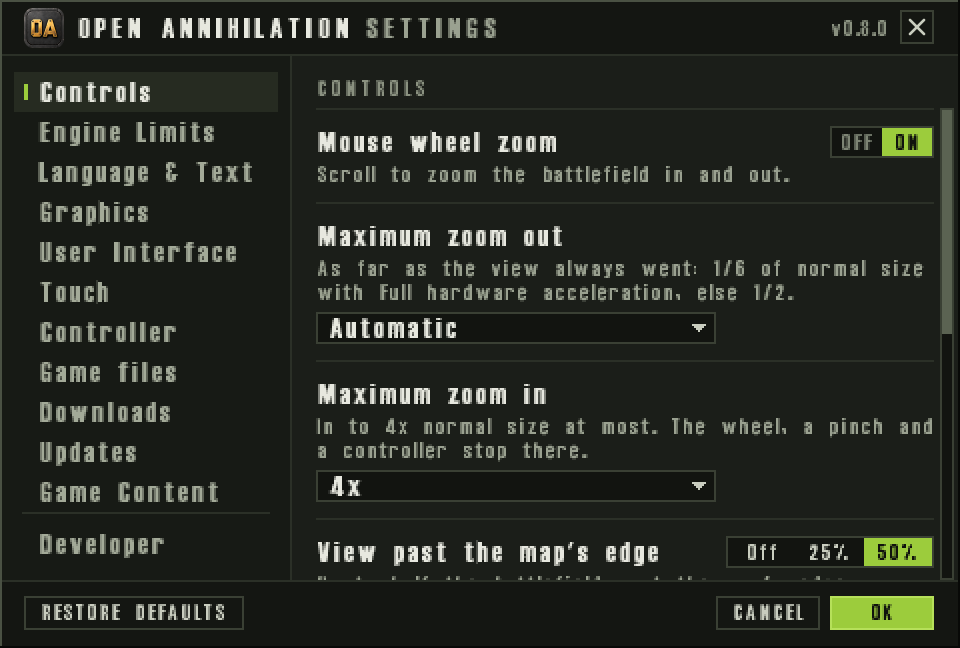

Each of these takes effect at once.

- **Key layout** is a card at the top of the section. [Keys](keys.md)
  is the chapter: the editor, the layouts, sharing and the default chords.
  The card shows the layout in use,
  its whole name, a badge counting your own changes to it ("4 changes of
  your own", none while you have changed none), where it applies
  ("Applies to every game.", or "Applies with {mod} only." while the mod
  you play chooses its own), and the key that shows the keys in a match
  ("Ctrl+/ in a match shows the keys.", Cmd+/ on a Mac). **Edit keys…**
  opens the key editor over Settings, in the menus and in a match, and
  saving there updates the card. **Change layout…**, on the main menu
  only, opens the Library on Keys, where USE chooses a layout. The buttons
  stand beside the words where they fit, and under them where they do
  not. The layout itself is chosen in the editor, or with USE in the
  Library.
- **Key layout with <mod>** is shown only while a mod is played. Same as
  the game uses Key layout. The other choices are the layouts you have
  installed, those made for that mod first and marked made for it (for
  Ridge, "Ridge keys · made for Ridge"). The choice is kept at once under
  that mod, and Cancel puts the previous choice back.
- **Show keys on buttons**, On by default. Order buttons and build cells
  show their key in a corner.
- **Mouse wheel zoom**, On by default. The mouse wheel, or a trackpad's
  scroll, zooms the battlefield in and out smoothly about the pointer: the
  ground under the pointer stays under it on every frame of the zoom, as
  the pointer moves too, so a zoom out and back in comes back to where it
  began. A zoom keeps a camera's follow of a unit (**T**, or Ctrl+C for
  the commander): it zooms about the unit at the battlefield's centre, and
  the view goes on following it; a scroll ends the follow. The view goes
  past the map's edges, by a scroll, the minimap and a zoom, as far as
  View past the map's edge lets
  it; the battlefield is black past the map, and your aircraft stay in
  view where their flight takes them past its edges. Turned off, the view eases back to the game's own scale. Turn it off if the wheel zooms when
  you do not mean it to, or to use a mod's megamap, which takes the wheel
  only while this is off
  ([ui.megamap](mods/standard-hacks/ui.megamap.md)); the wheel itself can
  zoom out to the whole map (Maximum zoom out).
- **Maximum zoom out**, Automatic, Whole map, 1/32, 1/16, 1/8, 1/4 or 1/2,
  Automatic by default. How far out the wheel, a pinch, the touch zoom
  buttons and a controller zoom the battlefield. Automatic goes as far as
  the units are drawn whole, as the view always has: half the game's scale,
  or a sixth while Full hardware acceleration draws the battlefield. Whole
  map zooms out until the whole map fits the battlefield, filling it one
  way and fitting within it the other; each fraction zooms out to that
  share of the game's scale, or
  to the whole map if it fits first. Farther out than Automatic, the
  processor draws the battlefield in every tier, its terrain reduced so
  that it takes no longer than at half scale, and the units as Zoomed out
  units, in Graphics, says: as models, or as dots past After zoom. The fog
  grows with the map: on the largest maps, with Hardware acceleration Off,
  it can make a frame of the whole map up to about twice as long as one at
  half scale. Clicks, drags and orders work as ever: a click on a unit's
  dot picks the unit, and a press on the black past the map, at any zoom,
  gives its order at the nearest point of the map. Choose Whole map
  to see and command the whole battle at once.
- **Maximum zoom in**, None, 2x, 3x or 4x, 4x by default. How close the
  same zooms go: None keeps the game's own scale as the closest, the others
  that many times it. A view past a new limit eases within it about the
  battlefield's centre.
- **View past the map's edge**, Off, 25% or 50%, 50% by default, as far
  as the view has always gone. How much of the battlefield the view may
  show past the map's edges, from the first view of a match and by a
  scroll, the minimap, a finger's drag, a zoom and a jump to a point, at
  any zoom. 50% lets the map's edge reach the middle of the
  battlefield, or, with more than the whole map in view, the map's centre
  reach the view's edge; a zoom keeps the ground under the pointer under
  it wherever that takes the view. 25% lets a quarter of the battlefield
  show past an edge, or, with more than the whole map in view, the map's
  centre a quarter of the battlefield from its middle. Off keeps the view
  on the map, as 3.1c does, and centres the map in a view wider than it.
  At 25% and Off a zoom keeps to the limit too: where the view meets it,
  the ground under the pointer slides instead. A unit the camera follows
  toward an edge takes the view as far as the limit, where it stops; the
  follow goes on, and the view follows the unit again as it comes back.
  Choose Off or 25% to keep the black past the map out of a view zoomed
  far out.
- **Middle-click pans**, On by default. A middle click on the battlefield
  leaves a small mark where you clicked and scrolls the view from that mark
  towards the pointer. The view stays still until the pointer is a short way
  from the mark, then moves faster the further the pointer goes, up to the
  Scroll speed. The pointer shows the direction. Another click, a turn of
  the wheel, a key or leaving the window stops the pan, and that press or
  key does nothing else. Holding the middle button and dragging does the
  same until you let go. It does not start while the allied whiteboard is
  in use, in the menus, or on a panel. Turn it off to keep the middle
  button as it was.
- **Number keys select groups** is the key editor's switch, not a row
  here. It is 3.1c's own SwitchAlt option, so the console's `+switchalt`
  changes it too: on, a number key selects its group on its own.
- **Window edge**, Capture, Sticky or Free, Capture by default. What a
  window does with the pointer while a match's battlefield shows and the
  window has the focus. Capture keeps the pointer in the window: no push or
  flick takes it out, it rests on the last pixel of each edge and the view
  edge-scrolls, as it does in full screen. The game menu, the pause screen,
  Settings, Escape and a window without the focus let it go, and a click on
  the battlefield captures it again; the click that only brings the window
  back gives no order. Sticky holds the pointer on the window's edges until
  a firm push past the edge, or arriving there fast, lets it leave, as
  firmly as Edge stickiness says. It is held again once it has come back
  into the window and moved in from the edges. Free leaves a window's edge
  as the game did before. Full screen holds the pointer whichever is
  chosen. See [the window's edge](controls.md#the-windows-edge).
- **Edge stickiness**, 0.0 to 5.0 in steps of 0.1, 1.0 by default, under
  Window edge. How firmly Sticky holds: at 1.0 a push of about 300 points
  past the edge within half a second, or arriving at about 6250 points a
  second, lets the pointer go, and the push and the flick grow with the
  level, so 5.0 holds five times as firmly. At 0.0 the edge never holds.
  Only Sticky uses it: with Capture or Free it is greyed, says Needs
  Sticky, and keeps its value.
- **Group keys centre the view**, On a double press, Never or On every
  press, On a double press by default. A group's key always selects the
  group. On a double press, a second press of the same group's key within
  the double-press time (Accessibility's Double press), with no other key
  between, also moves the view to the group's centre, and one press leaves
  the view where it is. Never leaves the view. On every press moves it when
  the group is already exactly the selection, however long after the last
  press, which is what 0.8.6 did. 3.1c leaves the view where it is on a
  first press and on a second. It applies at once.

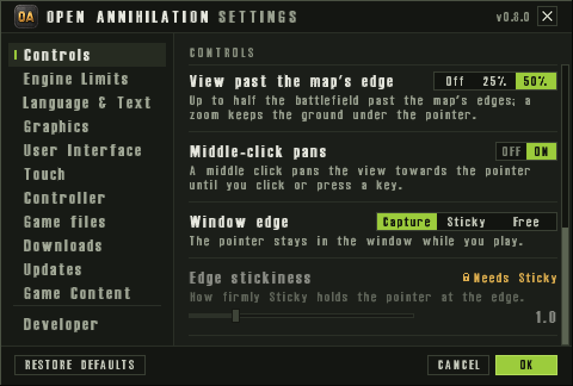

## Engine Limits

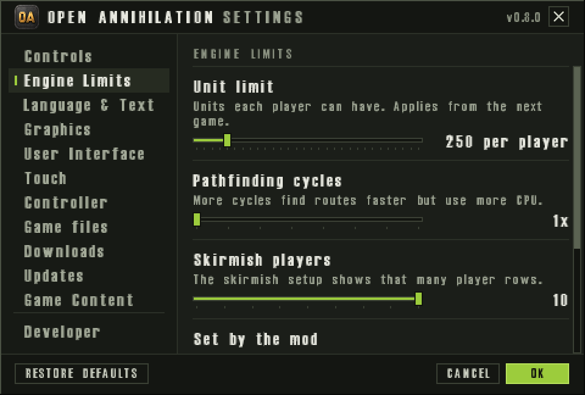

- **Unit limit**, 50 to 1500 units per player in steps of 50 (a mod may
  allow more). By default it is the unit limit your Total Annihilation
  installation sets, or 250 where it sets none; a mod may give a default
  of its own. It applies from the next game: a saved game keeps the limit
  it was saved with, and a multiplayer game plays the host's. Raise it for
  bigger battles; lower it if a slow computer struggles late in a game.
- **Pathfinding cycles**, 1x to 8x, 1x by default, the game's own amount.
  It multiplies how much route-finding work the game does each tick, shared
  by every player. More cycles find routes faster, so units of a large
  army start moving sooner after an order, but use more of the processor.
  It applies from the next game, and a multiplayer game or a replay always
  plays at 1x. Raise it on a fast computer if large groups hesitate before
  they move.
- **Skirmish players**, 2 to 10, 10 when you have not chosen a count. The
  skirmish setup shows that many player rows. It is the same count the
  setup's key codes store, so a code changes the slider and the slider
  changes what a code would set. A count you already stored stays, including
  one outside 2 to 10, until you move the slider.
- **Weapon types**, set by the mod. It counts how many weapon types the
  mod allows. The base game allows 256. In a match it shows how many of
  that limit the match loaded, as "312 of 4096". Every player in a game
  has the same count. The row never takes input.
- **Sides**, set by the mod. It counts how many sides the mod allows. The
  base game has 5. In a match it shows how many of that limit the match
  loaded, as "7 of 10". Every player in a game has the same count. The
  row never takes input.

The three sliders are locked during a game, and in a multiplayer game or a
replay they show "Set by the host". Weapon types and Sides never take a
focus, a key or a click. Resting on either says
"Set by the mod. Every player in a game has the same."

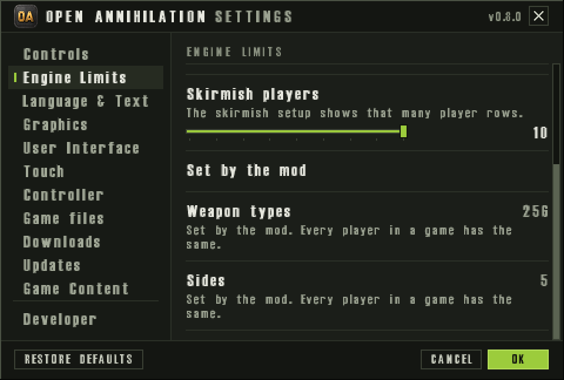

## Language & Text

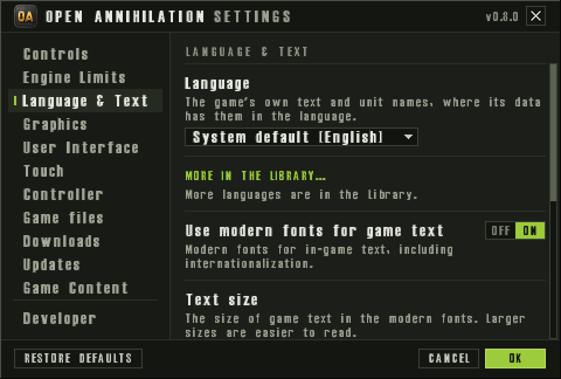

The Language & Text section says which language the game's text is shown in and
how that text is drawn. None of these changes the game itself, so no game
locks them, and players in different languages play together.

- **Language**: System default, English, Deutsch, Español, Français or
  Italiano, each named in itself, and any installed language pack's language, named in itself. System default, the default, follows your
  operating system's preferred languages, and the list says which it chose,
  as "System default (English)". The game's own text and unit names show
  in that language wherever the game data has them; whatever it leaves
  untranslated stays in English. A change shows at once in what is drawn
  every frame and on the menu under the settings, and in other screens and
  panels as they open. Choose a language to play in one other than your
  system's. 3.1c's own command line, such as `open-annihilation german`,
  decides it for the run.
  A registry's list can offer further languages. They are listed under
  AVAILABLE TO DOWNLOAD, after the installed ones, each with its size:
  whole kB under 1,000,000 bytes, one decimal of MB under 100 MB, and whole
  MB from there on. A pack the OA team published shows that size and a
  download mark. A
  community pack shows "community", the share of the game it translates
  when the catalogue gives one, and its size. A pack from a registry that
  was added shows "not reviewed" where a community pack shows
  "community". A registry whose downloads are off shows "downloads off",
  and its language stays greyed. Choosing one from the open list starts
  its download at once, with no question, and the field shows how far it
  has got (" · waiting", " · 40%", " · installing", or " · failed", which
  choosing it again retries); the hint says "Downloads, then switches to
  it." The language applies when the pack arrives, with no restart. OK
  keeps the choice. Cancel restores the language the dialog opened with. A
  download already started still installs, and the game keeps the language
  it had. The arrow keys move among System default and the installed
  languages only.
  [Languages](languages.md) says what the game data and the language packs
  translate.
- **More in the Library…**, under Language on the main menu, opens the
  Library on its Languages tab, over the settings, for every language pack
  the registries offer ([the Library](library.md)).
- **Use modern fonts for game text**, On by default. The game's text is
  drawn in modern fonts, which hold the letters of many languages and stay
  sharp at any size, in place of the game's own 8-bit fonts. Turn it off
  for the game's original look. Simplified Chinese is drawn only in them
  once its pack is installed: choosing it turns the switch On, and it stays
  On, locked, "Set by the language", while Simplified Chinese is chosen.
- **Text size**, 50% to 300% of the game fonts' sizes in steps of 10%, 80%
  by default. It sizes the modern fonts, so it is locked while they are
  off: the game's own fonts have fixed sizes. Raise it on a large or dense
  screen, or whenever the text is hard to read.
- **Font outline**, On by default: a dark edge round each letter of the
  modern text.
- **Font shadow**, On by default: a dark shadow under the modern text.
- **Game text background**, Off by default: a shaded box behind each line
  of game text.
- **Enable Unicode Multiplayer Chat**, Off by default. Chat lines in a
  shared game are written in UTF-8, so that players can chat in any
  language: the machines of players who have it on read them as written,
  and the others get each letter their code page lacks as `?`. Lines that
  start with `+` or `.` stay commands, as in 3.1c. A language written
  outside the code page, as Simplified Chinese is, or whose pack asks for
  it, turns it On, locked, "Set by the language", while that language is
  chosen, and so does a mod profile
  that sets [ui.text-rendering](mods/standard-hacks/ui.text-rendering.md)
  `unicode`. It changes no game, so players with it on and off play
  together.

The last three keep text readable over a busy battlefield. Turn on Game
text background where the text still gets lost; turn the outline and
shadow off for plainer text. Each takes effect at once.
[ui.text-rendering](mods/standard-hacks/ui.text-rendering.md) shows where
the game draws its text and how the modern fonts draw it.

## Graphics

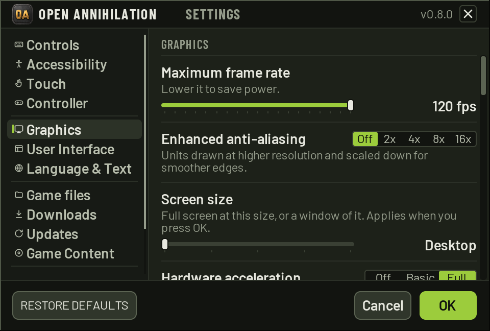

- **Maximum frame rate**, 30 to 120 frames a second in steps of 5, 120 by
  default. It caps how many pictures the game draws a second; the game
  itself plays at the same speed whatever it is. Above 30, the game's 30
  ticks a second, the pictures between two ticks show units and shots on
  their way from one tick to the next, unless **Smooth motion** is Off.
  Lower it to save power, heat or battery, or to keep a slow computer's
  frame rate steady. It takes effect at once.
- **Enhanced anti-aliasing**, Off, 2x, 4x, 8x or 16x, Off by default. It
  smooths the jagged edges of units. While the processor draws the
  battlefield (Hardware acceleration Off or Basic), units are drawn at that
  many times the resolution and scaled down; 8x and 16x need a fast
  processor. While the graphics card draws it (Full), the card draws the
  whole battlefield with that many samples across each pixel, as far as
  the window's size and the card's memory allow, and the hint says when it
  draws fewer. Raise it for smoother edges if the frame rate holds.
- **Screen size**, Desktop or any size the display offers from 640x480
  up, such as 2560x1440 or 3840x2160 on a 4K monitor and 3440x1440 on an
  ultrawide, Desktop by default. It applies when you press OK, on the menus
  and during a game, which carries on as it was. The sizes are those of
  the display the game's window is on. In full screen they are the
  display's modes from 640x480 up, including on a desktop that scales the
  frame and cannot switch the output's mode. In a window they are the
  modes that fit the desktop, with 640x480, 800x600, 1024x768, 1280x1024
  and 1600x1200 where they fit it. Sizes are listed once each, whatever
  their refresh rates, the narrower first, up to 8192 on a side. On a
  high-density display, such as a Mac's Retina display, they are in the
  desktop's points, as the system lists them, so that each one fits the
  screen. On Linux under Wayland the desktop size is that logical size:
  a 1920x1080 panel at 125% reports 1536x864. The game cannot change that
  output mode. Where the compositor can scale a frame, the panel's own
  pixel size is one of the full-screen modes, and full screen lists it.
  Choosing it draws at that size and scales the picture. Alt+Enter leaves
  the game on the desktop's mode.
  - In a window, the window takes the size at once, moved back onto the
    display where the new size would take it off. Resize the window by its
    edges and it keeps the size you give it: the setting then shows that
    size, or **Custom** where the display offers no such size, and
    choosing a listed size snaps the window back to it. Desktop leaves a
    window as it is.
  - In full screen, Desktop shows the screen at the desktop's own size and
    mode. On Windows, and on Linux with an X server of its own, another
    size switches the screen to the display's mode of that size, at the
    desktop's refresh rate where the display has it, as the original game
    did; Windows puts the desktop back as the game leaves full screen, is
    switched away from or ends. On macOS, on Linux under Wayland (and X11
    programs within a Wayland session), in Steam's Game Mode, and wherever
    the display has no mode of the size, the screen keeps the desktop's
    mode: the game draws at the size and scales the picture to the screen,
    letterboxed or in whole steps as **Menu scaling** says. The pointer in
    the black bars around the picture rests on its edge, where it scrolls
    the battlefield. A size chosen in full screen is the window's size
    once you leave full screen.

  The next start opens as you left it. Full screen opens full screen on the
  same display when that display is still connected, and otherwise on the
  main display, at this Screen size. A window opens at the size and place
  it had, on that display when it is still connected and otherwise on the
  main one, kept wholly on the screen and made smaller when that display
  is smaller. Alt+Enter, the window's own full-screen button, moving or
  resizing the window, and Screen size are remembered as they happen, and
  again when the game closes. A start with `-d`, or with `--resolution`,
  uses that choice for the one run and does not change what is remembered.
  The first start is unchanged: full screen on Windows, and a window on
  the other desktops.

  A size the display no longer offers, as when another monitor is
  connected, starts at Desktop; the setting keeps it for when the display
  offers it again. The options' Screen Size, under Visuals, lists the same
  sizes in the same words, outside a match and in one: the in-match column
  draws the control under the shadows. It shows Custom for a window sized
  by hand, and applies the size chosen when the options close with OK.
  Their Restore Default sets it back to its default. The battle room's RES
  column lists the same sizes and applies one as soon as you step to it.
  Desktop is a stop on this setting only. Choose a size for the period
  look, for an old monitor, or so that a slow computer has fewer pixels to
  draw.
- **Hardware acceleration**, Off, Basic or Full, Full by default. It says
  how much of the drawing the graphics card does:
  - **Off**: the processor draws and scales every frame, as the game always
    did.
  - **Basic**: the graphics card scales and composes the frames, so the
    picture fills the window evenly; the processor still draws them.
  - **Full**: the card also draws the battlefield, smoothed at every zoom,
    and Maximum zoom out's Automatic reaches a sixth of the game's scale,
    three times as far as the processor's drawing allows. It does not yet
    draw the small lens that a shot of a weapon with render type 2 makes of
    the ground under it; Basic and Off do.

  The card is used only where it can do the work and the computer has at
  least 2 GB of memory. Where Full cannot run, Basic draws in its place;
  where neither can, the processor does. The row's two status lines say
  which is in use and, if not the one chosen, why. At each start the game
  first has the card draw a few known patterns and reads them back, and
  it does not use a card that draws them wrongly. A graphics driver that
  stopped the game or failed twice in a row is passed over at later starts
  (once is enough on Linux and on Windows XP, where such a stop can halt
  the whole computer), and the main menu says so once. Setting it to Off
  and back, or Restore defaults, tries the card again. Each change takes
  effect at once, except during a multiplayer game or a replay: there Off
  applies at once, and Basic or Full from the next game. Leave it at Full
  for the smoothest picture and zoom; set it to Basic or Off if the
  graphics card or its driver misbehaves.
- **Vertical sync**, Off by default. Each frame waits for the display, so
  no frame tears, and the frame rate keeps just below the display's. Turn
  it on if you see tearing lines when the view scrolls. It takes effect at
  once, keeps its value for the length of a multiplayer game or a replay,
  and shows "Not available here" where the renderer cannot offer it.
- **Smooth motion**, Off or On, On by default. The game plays 30 ticks a
  second and draws up to Maximum frame rate pictures a second. On, the
  pictures between two ticks show units, the parts of them that move and
  spin, shots, debris and sparks part of the way from one tick to the next,
  so they move smoothly. Off draws every picture where the latest tick left
  them, as the game drew them, so they move 30 times a second however many
  pictures are drawn, and the pictures between two ticks repeat the tick's;
  the units of a player on another machine still move from tick to tick
  evenly between that machine's updates. A fast spin, such as a moho mine's
  arms, then seems to turn more slowly or to flicker, as it did in the
  original game; On shows its true speed. The frame rate, the camera's
  scrolling and zoom, the pointer and the interface are the same either way,
  and a camera following a unit keeps it still on the screen. It changes
  only what your screen shows, never the game, and takes effect at once, in
  a multiplayer game or a replay too. Turn it off if you prefer the original
  game's look.
- **Native pixel density**, Off by default; it applies from the next start.
  The window opens at the display's own pixel density, the Retina
  resolution on a Mac, in place of the window system's, so the picture can
  use every pixel of a high-density display. It needs at least 2 GB of
  memory, and a run started with `--no-hardware-acceleration` keeps it off.
  Turn it on for a sharper picture on such a display, if the frame rate
  holds. It is always on on an iPhone and an iPad. The setup, this dialog
  and the menus around the game's picture already lay out in points and
  draw at the display's density, whether or not this switch is on. The
  switch is the match and the game's own picture.
- **Explosion flash**, Off, Reduced or Full, Full by default. Every
  explosion lights up the ground around it for under a second, brightest at
  its centre and nearly white where flashes overlap, as the game always
  drew it; when a unit is destroyed each piece that bursts flashes, so a
  big battle can light the battlefield white. Reduced lights it at half
  strength; Off draws no flash at all. A mod can design its explosions to
  flash less ([ui.explosion-flash](mods/standard-hacks/ui.explosion-flash.md)),
  and the lower of the two is drawn, so a mod can never make them flash
  more than you chose. It changes only what your screen shows, never the
  game, and takes effect at once, in a multiplayer game or a replay too.
  Choose Reduced or Off if flashing light is uncomfortable for you.
- **Fog of War**, Classic or Smooth, Smooth by default. It says how the
  graphics card draws the edges of the fog of war (Hardware acceleration
  Full): the black over ground never seen, and the greyed ground seen
  before but out of sight now.
  - **Classic**: hard edges that step from sight cell to sight cell, drawn
    through the game's own fog tiles, as the original game drew them. The
    greyed band along an edge reaches a few pixels past the black, and
    under the game's dithered fog (`+dither`) that band, like all ground
    out of sight, has every other pixel blacked out: the thin chequered
    fringe the original game shows. Zoomed in or out the dither stays one
    screen pixel fine, as the original game's is at its own scale.
  - **Smooth**: soft edges that fade across each sight cell.

  Under Smooth the dithered fog darkens ground out of sight evenly, by the
  tone the original game's dither averages to.

  While the processor draws the battlefield (Hardware acceleration Off or
  Basic) the fog is always Classic, as the original game drew it. It
  changes only what your screen shows, never what any player can see, and
  takes effect at once, in a multiplayer game or a replay too.

  The processor's dither is one screen pixel fine at every zoom too; where
  the graphics card enlarges the processor's picture (Basic, zoomed in) it
  is drawn as the even darkening it averages to.
- **Zoomed out units**, Rendered or Dots, Rendered by default; Icons is
  shown but cannot be chosen yet. It says how units are drawn when the
  view is zoomed out farther than After zoom. Rendered draws every unit,
  wreck and shot as at any zoom, however far out the view goes: on a large
  map zoomed out to the whole map that takes a fast processor, and memory
  for every map pixel in view, and where a computer cannot spare an eighth
  of its memory for that, its units are drawn as dots there. Dots draws
  each unit as a small square of its owner's colour, framed while
  selected, with no health bars; a frame of the whole map then costs no
  more than one at half scale. Clicks, drags and orders work either way,
  and a click on a unit's dot, or where it would be, picks the unit. It
  takes effect at once.
- **After zoom**, 1/2, 1/3, 1/4, 1/6, 1/8, 1/12 or 1/16, 1/6 by default,
  locked ("Needs Dots") while Zoomed out units is Rendered. Farther out
  than this share of the game's scale, units are drawn as dots; closer in,
  as models. 1/6 is about where units stop being told apart. With Maximum
  zoom out at Automatic the view never goes farther out than 1/2, or 1/6
  with Full hardware acceleration, so choose a farther Maximum zoom out to
  see the dots.
- **Allow Full 3D Mode**, On by default. With Full hardware acceleration,
  Alt+drag on the battlefield (Option+drag on a Mac) turns the camera
  about the point under the pointer, and Alt+Shift+drag pans it; Alt or
  Option with the middle button turns it too. Alt+R (Option+R) puts the
  classic view back. A match always starts in the classic top-down view,
  and Off keeps it there. While an order or a building is armed, Alt+click
  still places it unsnapped (the click snap's override key) and leaves the
  camera alone. With Hardware acceleration Off or Basic, Alt and its drags,
  Alt+R and Alt+U keep their classic uses. The rotated view is drawn by the graphics card
  through Metal on a Mac or Vulkan elsewhere: on Windows 7 to 11 and Linux
  where the card's driver offers Vulkan, but not on Windows XP or 95 to
  Me. Where neither can be used, the first turn fails once and the view
  stays classic, and Alt keeps its other uses for the rest of the run.
- **Unlocked Camera**, Off by default, locked ("Needs Allow Full 3D Mode")
  while Allow Full 3D Mode is Off. On lets the camera turn beyond the
  angles at which the game's flat art still looks right. Alt+U (Option+U)
  turns it On or Off during a match and keeps the choice.
- **Coloured weapon lighting**, **Nanolathe glow**, **Wreck glow** and
  **Heat distortion**, each from 0% to 200% in steps of 10%. By default
  with Full hardware acceleration, Coloured weapon lighting and Nanolathe
  glow are 20%, Wreck glow 30% and Heat distortion 40%; below Full all four
  are 0%, so Off and Basic keep the game's own look. Setting Hardware
  acceleration from Full to Basic or Off turns all four to 0%, and back to
  Full turns each to its own default; below Full each can still be turned
  on. Zero leaves the effect out
  and 100% draws it at its standard strength. A weapon lights in the colour
  its shot is drawn in: a laser or a lightning bolt in its beam's colour,
  shells, plasma and missiles in a warm light. The lighting sliders change how bright a light is, never how
  far it reaches or how long it lasts; Heat distortion changes how far the
  shimmer moves the picture. They apply in the classic and the rotated
  view and take effect at once, in a match too. A saved Off or On from an
  earlier build reads as 0% or 100%.
- **Water ripples**, **Coastal waves**, **Underwater shimmer** and
  **Naval reflections**, each from 0% to 200% in steps of 10%: by default
  Water ripples 60%, Coastal waves 30%, and Underwater shimmer and Naval
  reflections 100%. They are locked ("Needs Full acceleration") while
  Hardware acceleration is not Full. They apply in the classic and the
  rotated view, and zero leaves the effect out.
  - **Water ripples** move the map's own water art gently in one direction
    the map keeps, the same after a saved game is loaded: broad swells and
    fine ripples at different speeds, the finer ones shown only up close.
    What lies on the sea bed, such as an underwater metal patch, moves with
    the art and lies under the water's foam and rings, while the shore and
    land stay still. Visible naval shots and hits stir the water around
    them, and shells that strike the water splash. Torpedoes and their hits
    stay at their depth and make no splash.
  - **Coastal waves** run toward the shore, gentler on small, sheltered
    water. Their foam takes the colour of the map's picture under it,
    lighter than the ground there, so that it blends with sand, grass,
    rock, snow or dark water rather than drawing a white line round
    every shore.
  - **Underwater shimmer** tints and lights only the parts of units,
    wrecks and shots that are under the water, more the deeper they lie;
    what stands above the water keeps its colours. In the classic view,
    scenery the map draws in its own art, such as an underwater metal
    patch, keeps the colours the map gives it, as the water's art around
    it does, so that it blends into the water as the game draws it. At 0% your own units under the
    water are darkened and tinted blue as the game draws them at every
    other Hardware acceleration.
  - **Naval reflections** draw a faint, soft picture of each visible
    surface ship on the water, mirrored under its hull: each part of the
    ship shows as far below its waterline as it stands above it, fainter
    the higher it stands. They fade as the view turns flat.

  They follow the map's sea. On a lava world (a map whose OTA sets
  `lavaworld=1`) the lava shows none of the four, as the game draws it:
  no ripples, waves, rings or splashes, no shimmer on what lies in it and
  no reflections, and shots that land in it show the game's own lava
  splash. Where the map's sea swallows shots without a splash
  (`nosealeveltrigger=1`), shots and naval guns leave no rings or
  splashes on it; its waves stay. A map whose water does damage
  (`waterdoesdamage=1`, such as an acid world) keeps all four.

  Fine detail fades as the view zooms out, and the reflections of distant
  fleets are kept few. These effects change only what your screen shows,
  never the water's depth, movement or what any player can see. With
  shadows on and Full hardware acceleration, an aircraft's shadow also has
  a soft edge, a little wider once it climbs to cruise height above the
  ground or water under it; it keeps the place and the darkness it has at
  every other Hardware acceleration.

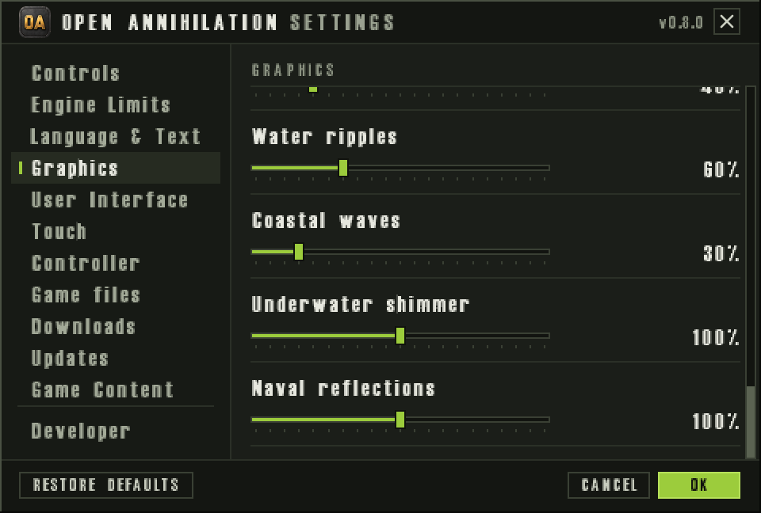

Some computers start with other defaults, which Restore defaults puts back
and which a value you choose always replaces:

- a **light computer**, one with a single processor, a processor without
  SSE2 (a Pentium III or an Athlon XP) or less than 512 MB of memory,
  starts at 800x600 (640x480 when its desktop is smaller), at 60 frames a
  second, with Enhanced anti-aliasing off;
- a **Raspberry Pi** starts at 60 frames a second;
- a **Steam Deck** starts at its screen's rate, 60 frames a second on the
  LCD model and 90 on the OLED, with the touch controls' Control size at
  Larger ([Steam Deck](installation/steam-deck.md)).

## User Interface

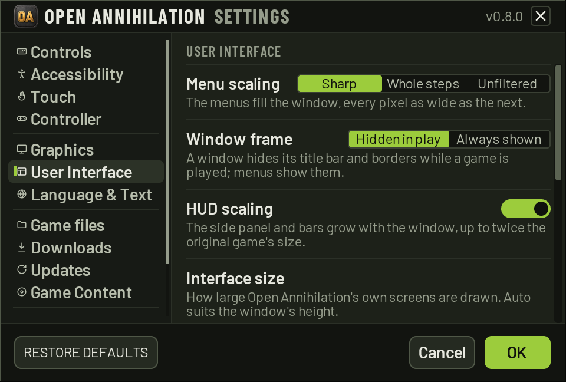

The User Interface section says how Open Annihilation's own screens, the
window and the side panel are drawn, where OA's windows stand, whether
Escape opens the game menu, and the look of OA's own letters. Each
setting takes effect at once, except Window size, which applies when you
press OK; Interface size and Look show at once and are kept when you
press OK.

- **Menu scaling**, Sharp, Whole steps or Unfiltered, Sharp by default. It
  says how the menus, drawn at 640x480, fill the window, and how a game in
  full screen drawn at a Screen size of its own fills the screen, and takes
  effect at once.
  - **Sharp**: as large as the window holds, every pixel as wide as the
    next, where the graphics card can.
  - **Whole steps**: the largest whole-number scale that fits; the menus
    are smaller, with a black border, but every pixel is square.
  - **Unfiltered**: they fill the window as the game always drew them.

  Choose Whole steps for the crispest pixels, or Unfiltered for the
  original look.
- **Window frame**, Hidden in play or Always shown, Hidden in play by
  default. In a window, Hidden in play hides the window's title bar and
  borders while you play a game, so that only the battlefield shows, and
  brings them back while the game menu, or a panel it opens, is up and on
  every other screen, where the window can be moved and closed. Always
  shown keeps them on every screen. The battlefield keeps its size either
  way, and full screen has no frame to hide. It takes effect at once.
- **HUD scaling**, Off or On, On by default. On, the side panel with its
  minimap and build menu, and the top and bottom bars of a game, grow with
  the window up to twice the original game's size, as on a 1280x960
  window, and the battlefield takes the rest. Off, they keep the original
  game's 640x480 size on every window, and the battlefield takes all the
  room they leave. Clicks and the minimap follow either way, and at
  640x480 the two look the same. The touch controls keep their own sizes.
  It takes effect at once, in a game too.
- **Interface size**, Auto, 100%, 150%, 200%, 300% or 400%, Auto by
  default: how large Open Annihilation's own screens are drawn. These are
  the settings, their notices and questions, the Library, the key editor,
  the map browser, the mutator and brain pickers, the update centre and
  its prompts, GET MAP in the battle room, the Add registry window, the
  check that you are a person, the battle room's player cards and the UI
  kit gallery. The 3.1c screens keep Menu scaling, the game's text keeps
  Text size and the side panel and bars keep HUD scaling.
  - **Auto** draws them at the nearest size to the window's height in
    pixels divided by 720, and a tie takes the larger size. While Use
    modern fonts for game text is On and those fonts opened, Auto chooses
    among 1x, 150%, 2x, 3x, 4x and so on: 1x below 900 lines, 150% from
    900, 2x from 1260 and 3x from 1800. While the modern fonts are Off, or
    they did not open, Auto keeps whole steps: 1x below 1080 lines, 2x
    from 1080 and 3x from 1800. Where one step smaller gives the screens
    the Large layout, or the layout Window size chose, and that size does
    not, Auto takes the step. Either way it is never below the display's
    own pixel density, so a phone keeps the smallest layout, and never
    larger than lets the smallest layout fit the window.
  - **A size you choose** is used as far as the smallest layout still fits
    the window, so 400% on a 1920x1080 window draws at 3x, and it never
    steps down. 150% is offered only while Use modern fonts for game text
    is On, because the game's own fonts draw only at whole steps; turning
    the modern fonts off while it is chosen sets 100%.

  At that size each screen takes the largest of three layouts whose
  settings dialog fits the window with 24 points round it: Compact, the
  480x324 dialog of earlier versions; Regular, 720x486, from 768x534
  points; and Large, 960x600, from 1008x648 points. So a 640x480 window
  draws exactly as earlier versions did, 800x600 draws Regular, and
  1024x768, 1280x720 and 1280x800 draw Large, all at 1x. At 1920x1080 Auto
  draws Large at 1x with the game's fonts, where 2x would leave room only
  for Regular, and Large at 150% with the modern fonts on. At 2560x1440
  it draws Large at 2x, and at 3840x2160 Large at 3x.

  In a match the settings measure the whole window, less the safe insets
  on a touch screen: they are centred in it, or centred in the room right
  of the side column where the middle would cover the column and that
  room holds them, at no more than the side column's scale. With HUD
  scaling On, 640x480 shows Compact at 1x where it always stood, 800x600
  Regular at 1x, 1280x720 and 1920x1080 Large at 1x, 1920x1080 Large at
  150% with the modern fonts on, and 2560x1440 and 3840x2160 Large at 2x.

  Interface size takes effect as you choose it, so the open dialog and
  every OA screen redraw at the new size at once, and is never locked.
  Cancel puts back the size the dialog opened with; OK keeps the size you
  chose. Choose a larger size if OA's screens are small to read on a large
  display, or a smaller one to see more of a list at once.
- **Window size**, Auto, Compact, Regular or Large, Auto by default: the
  layout Settings, the Library and OA's other windows take, in the menus
  and in a match. Auto takes the largest whose dialog fits the window with
  24 points round it, as above. A layout you choose is used wherever its
  dialog fits the window whole, and elsewhere the largest that does, and
  Auto's scale then steps down for it instead of for Large, so on a
  1920x1080 window Compact draws at 2x. It applies when you press OK.
  Choose a layout if you want the same one on every window.
- **Reset window positions**: **Reset** puts every window you moved back
  in the middle, at once, and the hint then says "Every window is back in
  the middle." Cancel does not move them again. The places you gave the
  overlays are kept ([Arrange overlays](controls.md#arrange-overlays)).
- **Escape opens the game menu**, On by default on macOS and Off
  elsewhere. The first Escape cancels an order or clears the selection, as
  in 3.1c; the next opens the in-game menu. Turn it on if F2 is awkward to
  reach, as on many Mac keyboards.
- **Look**, Modern or Classic, Modern by default: the letters of Open
  Annihilation's own screens and overlays. These are Settings and its
  notices and prompts, the Library, the key editor, the brain and mutator
  pickers, the welcome setup, the UI kit gallery, the cards that show
  over the rooms, and the overlays in a match (the keys panel, the latch
  chips and the notices). It applies as you choose it, the open dialog
  with the rest; Cancel puts back the look the dialog opened with, and
  Restore defaults puts Modern back.
  - **Modern**, "Open Annihilation's own screens in Barlow, a clear modern
    face.": labels, values and buttons in Barlow SemiBold, hints and small
    text in Barlow Regular, and the tracked capitals of window titles and
    section headings in Barlow Condensed. A line in Greek or Cyrillic,
    which Barlow lacks, is drawn whole in DejaVu Sans, so a word never
    changes typeface part way; Chinese, Japanese and Korean come from the
    language's own face, and emoji from Noto Emoji. Barlow is drawn sharp
    at its own size at every Interface size, 150% among them, and the
    layout is the same at each.
  - **Classic**, "Open Annihilation's own screens in the game's own
    fonts.": the game's two bitmap fonts at their own sizes, as 0.8.6 drew
    every OA screen. The colours, shapes and spacing are the same in both
    looks; only the letters differ.

  The 3.1c game's own screens, its menus, rooms, side panel, briefings and
  game text, keep the game's fonts in both looks. Game text has its own
  switch, Use modern fonts for game text, in
  [Language & Text](#language). A preferences file written before this
  setting existed, by 0.8.6 or earlier, reads as Modern too, so a player
  who updates sees Modern until choosing Classic. A file named with
  `--preferences-file` starts in Classic. The setting is
  `open-annihilation.ui.look`, `modern` or `classic`; any other text
  reads as the default.

## Accessibility

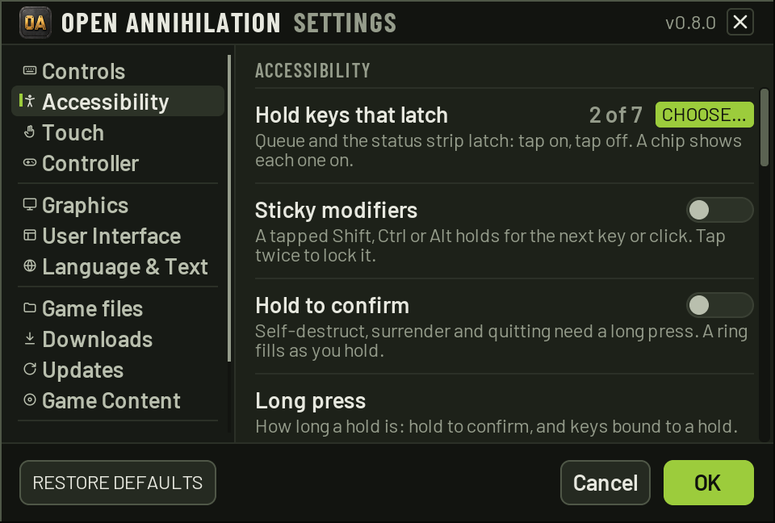

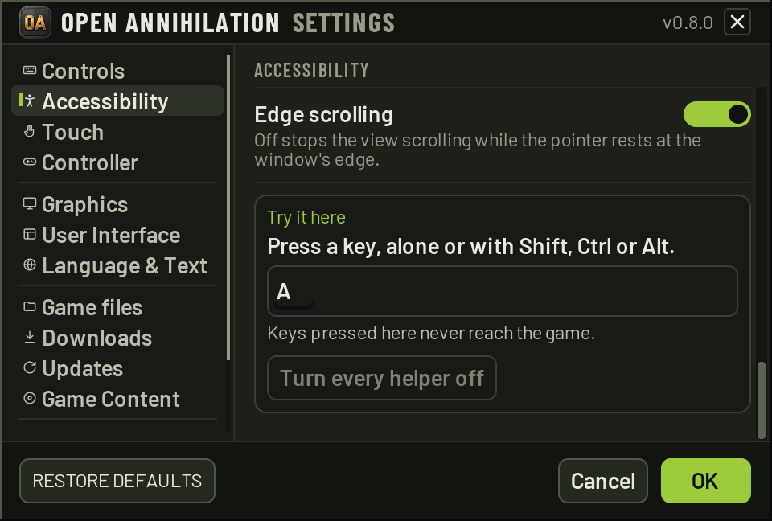

The Accessibility section gathers the input helpers in one place.
[Keys](keys.md#accessibility) lists each helper, what it does in a match
and where it is kept. Each
setting takes effect at once. The pictures show two of the seven latchable
actions on, so Hold keys that latch reads "2 of 7".

Beside the rows, or under the last one at Compact, a practice pad lets you
try the helpers before a match. It says what to try with the helpers that
are on ("Tap Shift, then press A." while Sticky modifiers is on), shows
the keys held, latched or locked, says what the last key did (latched,
locked, let go, counted, too short for Slow keys, bounced, or held long
enough for Hold to confirm, whose bar fills while you hold Ctrl + D), and
says that keys pressed there never reach the game. The pad takes Shift,
Ctrl, Alt, the letters and the digits while Accessibility is open; Tab,
the arrows, Enter, Escape and the other keys work the dialog as anywhere
else. **Turn every helper off** turns Sticky modifiers, Hold to confirm, Slow keys, Bounce keys, the
Order wheel and Pointer keys off at once; it is greyed while they are all
off.

- **Hold keys that latch** shows how many latchable actions the layout in
  use has turned on, of how many the game offers, as "2 of 7", and
  **CHOOSE…**. CHOOSE… opens the key editor on Latchable, over the
  settings. Key layout's Edit keys… still opens the editor on All. Queue
  and the status strip latch: tap on, tap off. A chip shows each one on.
- **Sticky modifiers**, Off or On, Off by default. A tapped Shift, Ctrl or
  Alt holds for the next key or click. Tap twice to lock it.
- **Hold to confirm**, Off or On, Off by default. Self-destruct, surrender
  and quitting need a long press. A ring fills as you hold.
- **Long press**, 200 to 1000 ms in steps of 50, 500 ms by default: how
  long a hold is, for Hold to confirm and for keys bound to a hold.
- **Slow keys**, Off, then 50 to 1000 ms in steps of 50, Off by default. A
  key counts only after it is held this long, for a hand that brushes
  keys.
- **Bounce keys**, Off, then 50 to 1000 ms in steps of 50, Off by default.
  A second press of the same key this soon is ignored.
- **Order wheel**, Off, Hold right or Hold middle, Off by default. Holding
  that mouse button opens the order wheel at the pointer.
- **Pointer keys**, Off or On, Off by default. The numpad moves the
  pointer; 5 clicks, 0 right-clicks.
- **Double press**, System, then 200 to 1000 ms in steps of 50, System by
  default. System uses the system's double-click time. Two presses this
  close are a double press, and two clicks a double click.
- **Key repeat delay**, System, then 150 to 1000 ms in steps of 50, System
  by default, and **Key repeat rate**, System, then 2 to 30 a second,
  System by default. System uses the system's repeat. Together they say
  how soon a held camera, speed or page key repeats, and how fast.
- **Drag threshold**, 32 to 96 px in steps of 8, 32 px by default: how far
  a press may move and still be a click.
- **Edge scrolling**, Off or On, On by default. Off stops the view
  scrolling while the pointer rests at the window's edge. Arrow keys, and
  the touch controls' edge band while a drag is held, keep moving the view.
- **Move overlays**, Off or On, Off by default. On, the keys panel, the
  chat line over the battlefield and the latch chips stand where you put
  them; off, where the game puts them, and your places are kept.
- **Overlay places**: whose places the overlays stand at, and
  **Arrange…**, which can be pressed while Move overlays is on. It opens a
  picture of the match where you drag them on a grid; each window size
  keeps its own places ([Arrange overlays](controls.md#arrange-overlays)).

## Touch

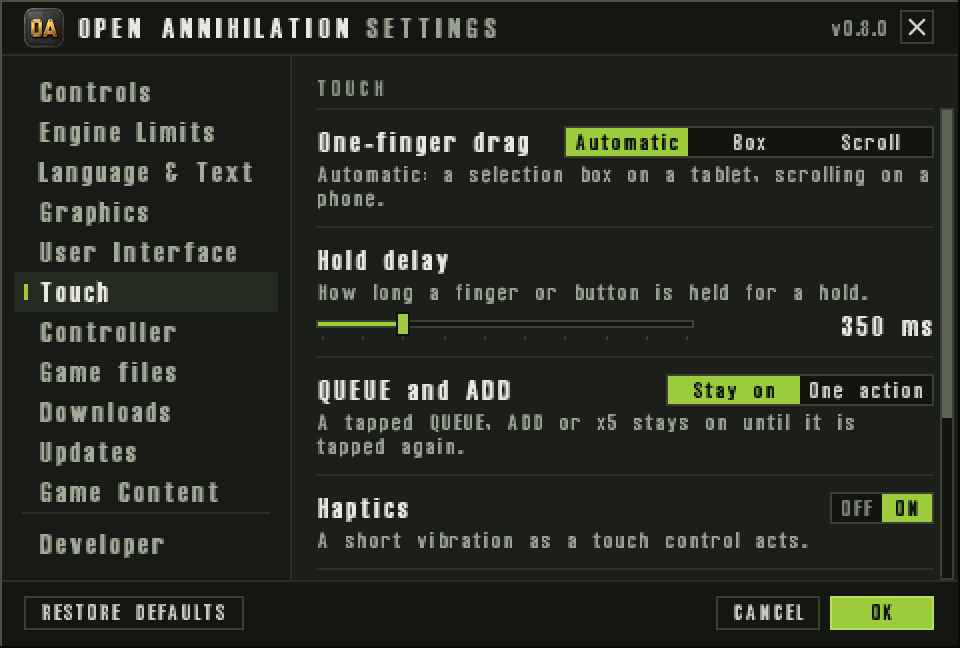

The Touch section shows while the game has touch controls: always on an
iPhone and an iPad, on a touch screen once a finger touches it, and with
`--touch-controls`. Each setting takes effect at once.

- **One-finger drag**, Automatic, Box or Scroll, Automatic by default:
  what a finger dragged across the battlefield does. Automatic draws a
  selection box on a tablet and scrolls the map on a phone. A hold then a
  drag always draws a box, and two fingers always scroll.
- **Hold delay**, 250 to 700 ms in steps of 50, 350 ms by default: how long
  a finger stays down before it counts as a hold, which opens the order
  menu or a control's help. Raise it if holds start when you mean to tap.
- **QUEUE and ADD**, Stay on or One action, Stay on by default: whether a
  tapped QUEUE, ADD or x5 stays on until it is tapped again, or turns off
  after the next order or selection.
- **Haptics**, On by default: a short vibration as a touch control acts.
- **Left-handed layout**, Off by default: the minimap and the thumb
  controls on the right, the orders on the left.
- **Control size**, Standard, Large or Larger, Standard by default: how
  large the touch controls are drawn; the game's own screens keep their
  size.

[Touch controls](touch-controls.md#touch-settings) describes them with the
gestures they change.

## Controller

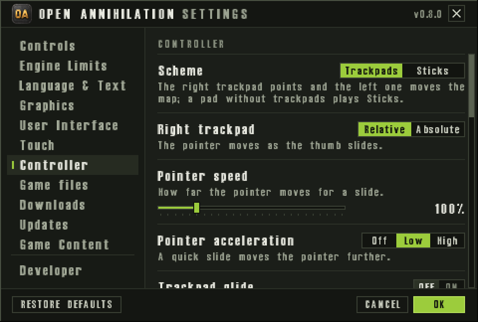

The Controller section shows once a gamepad has been used in this run.
Each setting takes effect at once.

- **Scheme**, Trackpads or Sticks, Trackpads by default. With Trackpads
  the Steam Deck's right trackpad points and the left one moves the map;
  with Sticks the right stick points and the left one moves the map. A
  gamepad without trackpads plays Sticks.
- **Right trackpad**, Relative or Absolute, Relative by default: the
  pointer moves as the thumb slides, or each point of the pad is a point
  of the view.
- **Pointer speed**, 50% to 300%, 100% by default; **Pointer
  acceleration**, Off, Low or High, Low by default, so that a quick slide
  moves the pointer further; and **Trackpad glide**, Off by default, which
  keeps the pointer moving after a quick flick. Change them if the pointer
  feels too slow, too fast or hard to place.
- **Right stick**, Zoom, Pointer or Nothing, Zoom by default: Zoom zooms
  the view about the pointer and, while building, turns the build page
  with a flick.
- **Magnetism (stick pointer)**, On by default: the stick's pointer
  settles on a lone unit near it.
- **Gyro pointer**, Off by default, or on while the right pad is touched,
  while the right stick is touched, or always, and **Gyro speed**, 50% to
  400%, 100% by default: turning the controller fine-tunes the pointer.
- **Haptics**, Off, Light or Strong, Light by default: small ticks and
  bumps felt through the controller.
- **Button prompts**, Automatic by default, or Steam Deck, Xbox,
  PlayStation, Nintendo or Off: the style of the button pictures the
  controls and rings show. Choose one if Automatic picks the wrong style
  for your gamepad.
- **Left-handed**, Off by default: the two sides' roles swapped, so the
  left pad points.
- **Control size**, **Hold delay** and **QUEUE and ADD**, the same settings
  as in Touch.

While the gamepad reaches the game through Steam Input, the section starts
with a notice in amber: Steam then hands the game the trackpads and back
grips as a mouse and keys, so turn Steam Input off for Open Annihilation to
use them here. [Gamepad controls](controllers.md#controller-settings) gives
each setting's choices and default, and what every input does.

## Game files

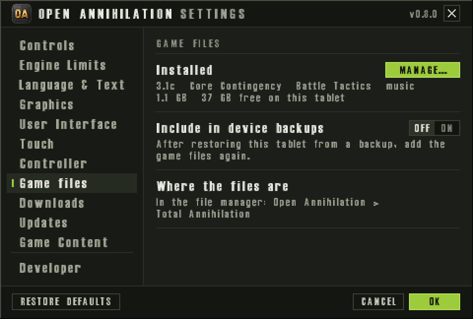

On an iPhone or an iPad, the main menu's settings have a Game files
section for the Total Annihilation files copied onto the device:

- **Installed**: what is installed, its size and the free space, and
  **Manage…**, which opens the Game files screen to check, add, replace or
  remove the files.
- **Include in device backups**, Off by default: the game files go into
  the device's backups too. They are large, and can always be copied
  again.
- **Where the files are**: the folder that holds them.

[Game files](game-files.md#managing-the-game-files) describes managing
them.

## Downloads

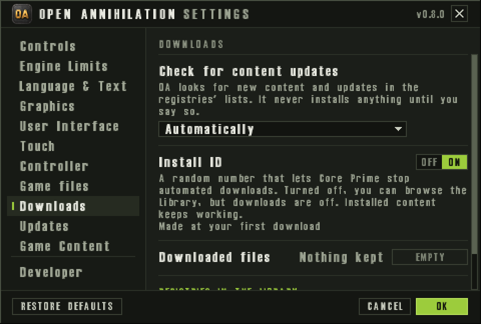

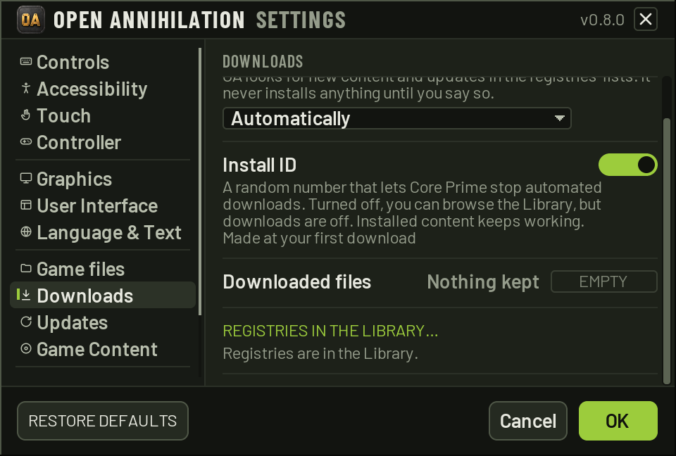

Downloads says when Open Annihilation looks for new content, holds the
install ID a registry asks for, and keeps the files downloads leave behind.
The registries themselves are in the Library.
[Downloads and privacy](downloads.md) explains each of them, and what a
download sends and records.

- **Check for content updates**, Automatically, Only when I open the
  Library or Never, Automatically by default: when OA fetches the
  registries' lists, which say what can be downloaded and which updates
  wait. Automatically fetches a registry's list as the game starts when the
  list it has is more than 6 hours old, and when the Library opens; Only
  when I open the Library, only then; Never, only when you ask
  ([when OA checks](downloads.md#when-oa-checks-for-content)). Whichever
  you choose, OA installs nothing until you press a button. It takes
  effect when you press OK.
- **Install ID**, On by default: a random number that lets Core Prime stop
  automated downloads, made at your first download from its registry.
  Turned off, you can browse the Library, but downloads from that registry
  are off; installed content keeps working. Before an ID is made, the
  line under the hint says "Made at your first download". Once one exists,
  a row labelled **Your install ID** shows it in part, as
  "7f3a90d2 · · · c91e", or "Off" while the switch is off, and **RESET**
  replaces it with a new random one at once. Each registry that asks for
  an install ID has its own,
  labelled "Install ID · *registry*" when there is more than one. The
  switch takes effect at OK; RESET acts at once, and Cancel does not undo
  it.
- **Downloaded files**: how much the download folder keeps for resuming and
  repairs, or "Nothing kept". **EMPTY** removes those files at once; it is
  greyed while nothing is kept, or while a download is using them.
- **REGISTRIES IN THE LIBRARY…**, on the main menu only: opens the Library
  on its Registries tab, where every registry is listed, switched, removed
  or added. The line under it says "Registries are in the Library." During
  a game the row is not listed. [The Registries tab](library.md#the-registries-tab)
  and [Registries](downloads.md#registries) explain adding one, mirrors and
  what "not reviewed" means.

During a game RESET and EMPTY are locked ("Locked during a game", as every
other locked row says). The check and the install-ID switch can still
change.

## Updates

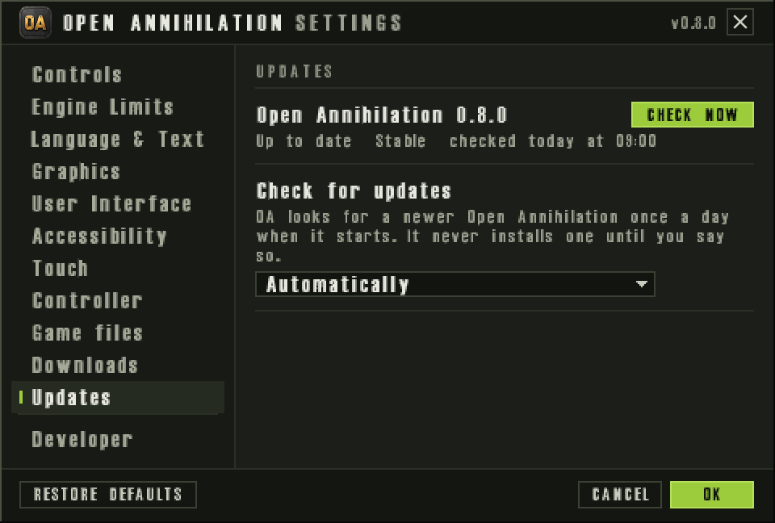

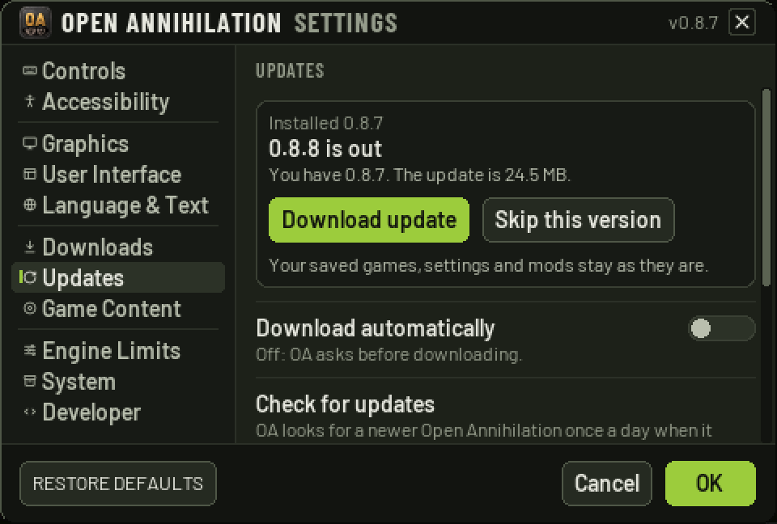

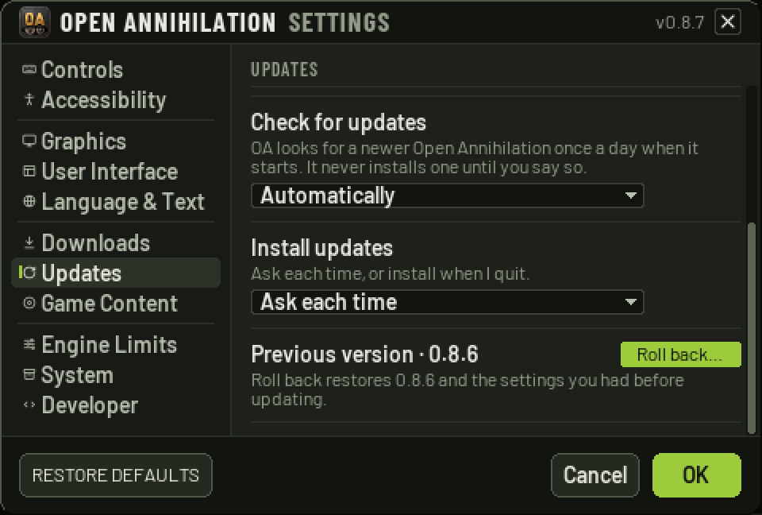

Updates says where an update of Open Annihilation stands, and when the
game looks for one, downloads it and installs it. The three pictures come
from the game itself, Settings at Compact over the main menu of a 640 by
480 window, cut to the dialog and drawn at 2×, so they list no Touch,
Controller or Game files; the version running there is 0.8.7, and 0.8.6
is kept.

- **The card** at the top: "Installed" and the version you are running,
  the state ("Up to date", "0.8.8 is out", "Downloading 0.8.8", "0.8.8
  is ready", "Not checked yet", "OA never checks" and the others
  [Updates](updates.md#where-an-update-stands) lists), a line of detail
  (the size of the update, the bytes done and the time left, or what
  went wrong), a bar while a download moves, amber while it is paused,
  the state's actions as buttons, the first in the accent, and a note
  under them. The actions are those the state allows: **Check now**;
  **Download update** and **Skip this version**; **Pause** or **Resume**,
  with **Cancel download**; **Install when I quit**, or **Don't install
  when I quit** once it is scheduled, with the action that installs now,
  named for the way this copy installs (**Install and restart**, **Open
  the installer** or **Close the game**); **Try this version** for a
  release you skipped; **Try again** and **Show details** after a
  failure. They act at once, and the dialog stays open. While a check
  runs the card has no button. With Check for updates at Never the card
  says "OA never checks" and offers no Check now.
- **Download automatically**, Off unless you turn it on. Off, OA asks
  before it downloads a release, as the hint says. On, a release that can
  be installed here starts downloading at the settled main menu, and
  stops during a match. It takes effect when you press OK. The setting is
  `open-annihilation.update-download`, `0` or `1`. Absent reads as off,
  so a found update is not fetched until you press Download update.
- **Check for updates**, Automatically, Only when I ask, or Never,
  Automatically by default. Automatically looks once a day when the game
  starts, after the main menu has settled. Only when I ask waits for
  Check now. Never makes no request, and Check now is not offered. It
  takes effect when you press OK. Cancel puts back the choice the dialog
  opened with. The hint says OA looks for a newer Open Annihilation once
  a day when it starts, and never installs one until you say so.
- **Install updates**, Ask each time or When I quit, Ask each time by
  default. Ask each time asks with the ready prompt when a download is
  ready. When I quit schedules a ready release for the next time you quit,
  without asking. It takes effect when you press OK. The setting is
  `open-annihilation.update-install`, `ask` or `when-i-quit`.
- **Previous version · {version}**, shown only while a version is kept,
  with **Roll back…** and the hint "Roll back restores {version} and the
  settings you had before updating." Roll back… asks once, showing what
  comes back and what stays as it is
  ([Rolling back](updates.md#rolling-back)). OA restarts on the kept
  version with the settings it had, and the version you leave is not
  offered again until a newer release. The row is locked during a game,
  as RESET is.

While a download moves or is paused, the section list shows its share
beside Updates, as "41%", and "ready" once a release is ready or
scheduled. The header of every Settings page, and the Library's header,
show the same short words beside the version where they fit, such as
"0.8.8 · 41%" or "0.8.8 is ready".

[Updates](updates.md) says what the check reads, what it sends, and what
it keeps.

## Game Content

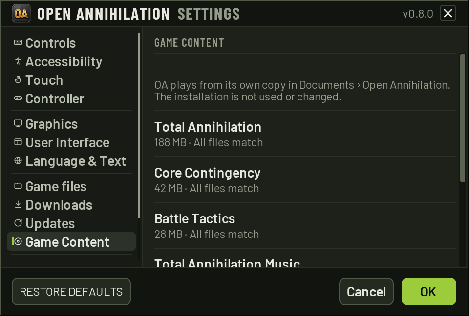

Game Content lists each base game and expansion, its size, and what the
last check said. A bundle that is not in the copy says "not added". A
bundle whose files differ is marked.

OA plays from its own copy in Documents › Open Annihilation. The
installation is not used or changed.

- **Check again** reads the copy on its own and the row shows "Checking…
  N%" until the result replaces it. The dialog stays open and keeps drawing.
- **Copy again from…** asks for a folder or an installer and copies from
  it into the same folders. The bundle's row shows how far the copy has
  got, its bar, and Cancel. Cancel leaves the copy that was already there.
  The dialog stays open and keeps drawing.
- **Open folder** opens the Games folder in the system's file manager.

## System

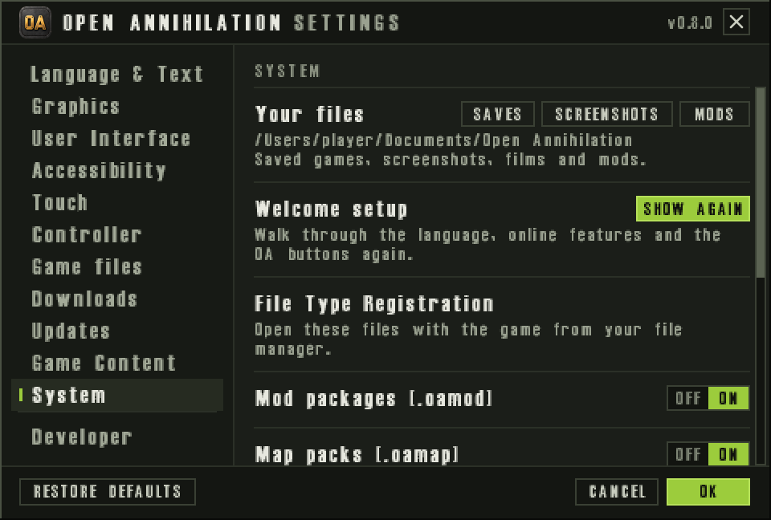

System is where the game sits on your computer: your own folder, and which
of the game's file types this copy opens.

- **Your files** is not a setting: it shows where your saved games,
  screenshots, films, recordings and mods go, the Open Annihilation folder
  in your Documents folder unless you moved it. **SAVES**, **SCREENSHOTS**
  and **MODS** open those folders in the system's file manager. Films and
  the recordings of network games are in its `Films` and `Recordings`
  folders, which have no button. `Saves`, `Screenshots`, `Films` and
  `Recordings` each hold a folder for each mod, named after its id, and
  `default` for games without a mod. The installation guides say what each
  folder holds and how to move the folder
  ([macOS](installation/macos.md#where-it-keeps-its-files),
  [Windows](installation/windows.md#where-it-keeps-its-files),
  [Linux](installation/linux.md#where-it-keeps-its-files)).
- **Welcome setup** walks through the language, online features and the OA
  buttons again. **SHOW AGAIN**, then **OK**, clears
  `open-annihilation.first-run`, and the welcome shows at the next main
  menu. **Cancel** leaves it as it was. During a game the row is locked
  and says "Choose from the main menu." The welcome itself is
  [the first-run setup](first-run.md).
- **File Type Registration**, on Windows, Linux and macOS. Eight switches,
  all On at first:
  - **Mod packages (.oamod)**
  - **Map packs (.oamap)**
  - **Language packs (.oalang)**
  - **Registry files (.oareg)**
  - **Mutator packages (.oamut)**
  - **Brain packages (.oabrain)**
  - **Key layout packages (.oakeys)**
  - **Launch files (.oalaunch)**: a launch file opened from the file
    manager starts the game in its battle room
    ([Opening a launch file](command-line.md#opening-a-launch-file))

  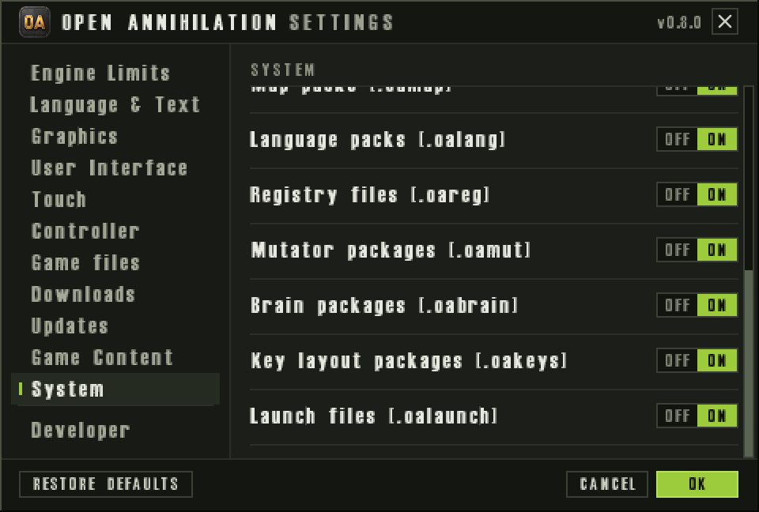

  The hint says "Open these files with the game from your file manager."
  **OK** applies a switch you moved, at once. **Cancel** leaves every
  opener as it was when the dialog opened. A switch you do not move is
  left as it is, including a choice you made in the file manager. Starting
  the game does not put a type back.
  Each switch is kept as `on` or `off` under
  `open-annihilation.file-types.` and its extension (`.oamod`, `.oamap`,
  `.oalang`, `.oareg`, `.oamut`, `.oabrain`, `.oakeys`, `.oalaunch`). A missing key, or any text other than
  `off`, leaves the type on. Each switch acts on its own type alone: moving
  one never registers, withdraws or changes the opener of another.

  On Windows and Linux, a switch that is on makes this copy of the game
  the opener of that kind of file, and one that is off withdraws that
  registration. The file manager takes the change with no restart. On
  Windows the installer also associates launch files with the game for
  everyone who uses the computer. Launch files Off withdraws your own
  registration and hides that association from your Windows account alone:
  it sets the (Default) of `HKEY_CURRENT_USER\Software\Classes\.oalaunch`
  to an empty text, which names no program, so Windows asks which program
  to open a launch file with. The other accounts on the computer keep the
  association. On registers this copy for you again in place of the empty
  text. While the switch is off, a program you choose for launch files in
  Windows stays your choice.

  On a Mac, a switch that is on means Open Annihilation is the program
  Finder uses to open that type. The switch shows that choice as it is
  now, not only what was stored. Off hands the type back to the program
  that opens a zip archive (the six packages, usually Archive Utility)
  or plain text (a registry file or a launch file). The app keeps the type
  and its icon either way; only the program that opens it changes. If the
  system refuses, the log says so and the switch shows the choice the
  system kept. When macOS keeps Open Annihilation as the opener, the hint under
  File Type Registration names each type that stayed, in one sentence:
  "macOS kept Open Annihilation as the opener of .oamod. To choose another,
  select a .oamod file in Finder, then File › Get Info › Open with ›
  Change All." Several types are named together, and the sentence then
  says to select one of them. The line is there the next time Settings ›
  System opens in this run, and it goes away when every switch matches
  what you asked. [macOS](installation/macos.md) says the same for opening
  a file.
- **File types**, on iPhone and iPad, in place of the eight switches. The
  system takes the types from the app, and there is no way to choose a
  default opener, so there is no switch. The hint is one sentence.

## Developer

The Developer section sits at the foot of the column, under the divider.

- **Enable Developer Mode**, Off by default. It lets you change the
  standard hacks of the mod being played, or of 3.1c without a mod, without
  editing the mod's `oamod.yaml`: turn a hack on or off and set its values,
  to try them before writing them into a profile. Off, the game plays the
  profile as it ships, and your changes are kept for when you turn it on
  again. On, they apply: a change to a view hack, which changes only what
  you see, at once, even in a running match, and a change to a sim hack,
  which changes the game itself, from the next match. A changed sim hack
  changes the profile's sim hash, as writing it into `oamod.yaml` would,
  so a game saved with it loads only with the same changes, and every
  player of a network game must have them. While it is on, a network
  game's battle room is told so.
- **Show performance statistics**, Off by default: the frame and tick
  times over the battlefield, the renderer in use, and a line saying
  whether the game shows in a window, full screen on the desktop's mode or
  full screen at a mode of its own (exclusive), the size it draws the
  battlefield at, and the display's size, refresh rate and scale (2x on a
  Retina display), as the `+stats` console command shows them. It works whether or not Developer Mode is
  on, and takes effect at once.
- **UI kit gallery** is not a setting: **SHOW** opens the gallery over the
  settings, every part of Open Annihilation's own screens in each of its
  states, at the size and layout the window gives them now (see Interface
  size, in [User Interface](#user-interface)). **CLOSE** goes back to the
  settings.
  It is for checking how OA's screens look, and for people building
  them ([the UI kit](extensions/ui-kit.md)).

Under them the section lists every standard hack, grouped by area, with a
switch for each and a control for each of its values. **Show Active Only**
shows only the hacks that are on, and **Restore profile values** clears
every change. Developer Mode keeps its changes for each mod apart. Restore
defaults turns it off but keeps the changes. At Regular and Large the list
scrolls in a view of its own under the three rows. At Compact the whole
section scrolls as one: the three rows, then the list, then Show Active
Only and Restore profile values, and the arrow keys walk from the rows
into the list and on to those two.

The hacks themselves are described in [Mod support](mods/README.md):
[Developer Mode](mods/README.md#developer-mode) in full,
[the table of every standard hack](mods/README.md#every-standard-hack), and
a page for each in [standard-hacks](mods/standard-hacks/).

## For one run: the command line

These options set a setting for one run without changing what is kept.
The row then shows "Set on the command line". The mod options choose the
mod for the run: the Library then says "The command line chose this run's
mod." and turns PLAY NOW and SWITCH OFF off.

| Option | Setting | For the run |
|---|---|---|
| `--max-fps N` | Maximum frame rate | N frames a second, 30 to 1000, or 0 for no limit |
| `--hardware-acceleration=off`, `=basic` or `=full` | Hardware acceleration | that level; `--hardware-acceleration` alone is Full |
| `--no-hardware-acceleration` | Hardware acceleration | Off |
| `--native-density` | Native pixel density | On |
| `--mod-dir PATH` | the mod (the Library) | plays the mod folder at `PATH` |
| `--base-game` | the mod (the Library) | plays 3.1c without the mod you chose |
| a language's name, as `german` | Language | that language, as 3.1c's command line names it |

Two more change what the settings show: `--touch-controls` turns the touch
controls on, and with them the Touch section, and `--user-folder PATH`
puts Your files' folder at `PATH`. `SDL_RENDER_DRIVER=software` in the
environment has the processor draw every frame, and Hardware acceleration
then says it is not in use.

## Where the settings are kept

The settings are kept in your preferences file, with the game's own
options. The installation guides say where it is
([macOS](installation/macos.md#where-it-keeps-its-files),
[Windows](installation/windows.md#where-it-keeps-its-files),
[Linux](installation/linux.md#where-it-keeps-its-files)), and
[user preferences](../src/platform/preferences/README.md) lists every key.
A setting you have never changed is not written, and follows its default.
The registries you add, and the built-in ones you turn off, are kept apart,
in `Registries.yaml` in your own Open Annihilation folder
([where it is all kept](downloads.md#where-it-is-all-kept)).
To turn Hardware acceleration off for good without starting the game, for
a graphics driver that stops it, set
`open-annihilation.hardware-acceleration` to `off` in that file; `basic`
and `full` name the other levels.

`--preferences-file FILE` reads and writes the settings in `FILE` instead.
Its defaults are then the game's own behaviour on every computer, so that
a check plays alike everywhere: Escape opens the game menu, Hardware
acceleration and Use modern fonts for game text all start Off, the
language is English, the unit limit is 250 (or the mod's own default when
a mod is played), and no computer has defaults of its own.
[The settings' module](../src/ui/engine-settings/README.md) describes the
dialog and every setting for developers.
